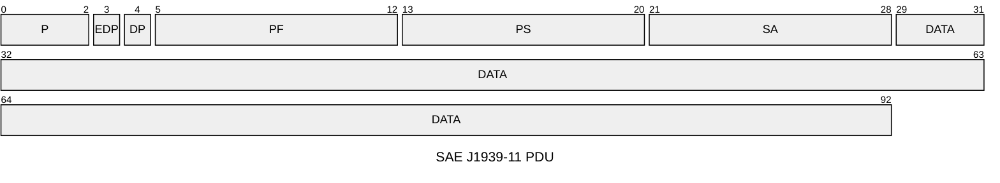
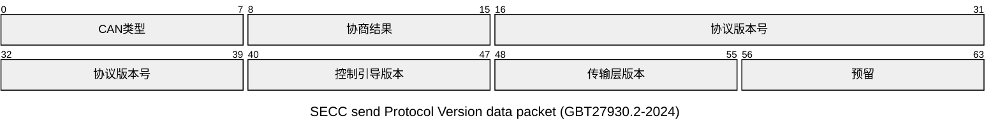
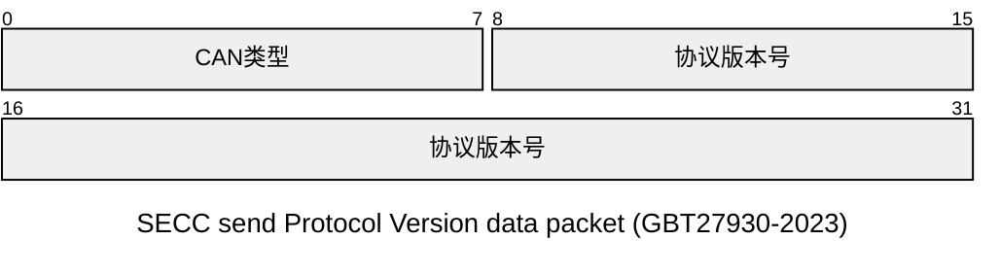
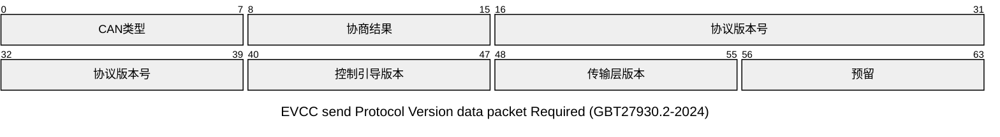
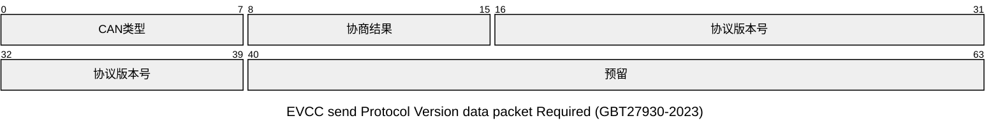
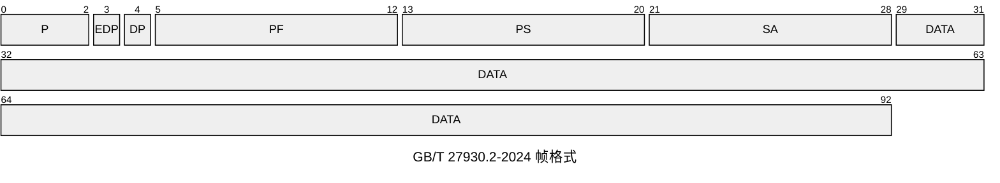

#A类系统 #B类系统 #GB-T-27930-2023 

`GB/T 27930-2015`与`GB/T 27930-2023`中**A类系统**基本相同 ,后续如未明确标注 ,则仅对比`GB/T 27930-2023`中**A/B系统**的差异
## 物理层
- 2015 :
	标准符合`ISO 11898-1`,`SAE J1939-11`皆可
- 2023 :
	标准符合`SAE J1939-11`,`SAE J1939-15`; 
- 对比 :
	`SAE J1939-11`与`ISO 11898-1`的**物理层**与**数据链路层**具有几乎相近的规范 ,`ISO11898-1`相对于`SAE J1939` 上层**传输层**等未有明确规范 
## 数据链路层

### PDU

- Ρ为优先权，从最高0设置到最低7。
- EDP为扩展数据页，预留后期扩展使用，本文件中为0。
- DP为数据页，用来选择参数组描述的辅助页，本文件中为0。
- PF为PDU格式消息类型，用来确定PDU的格式，以及数据域对应的消息类型。
- PS为 PDU特定格式，PS值取决于PDU格式，本文件中采用PDU1格式，PS值为目标地址。SA为源地址，数据帧的源地址。
- DATA 为数据域，不同消息类型的数据域定义见15章的规定。

新旧标准都基于`SAE J1939-11`,无明显变化.

### 地址分配

1. A类系统

| 设备              | 地址         |
| --------------- | ---------- |
| SECC(充电桩)       | 86(56*H*)  |
| EVCC(电动汽车通信控制器) | 244(F4*H*) |

2. B类系统

| 设备               | 地址        |
| ---------------- | --------- |
| SECC(充电桩)        | 95(5F*H*) |
| EVCC(电动汽车通信控制器)  | 37(25*H*) |
| VACC(车辆适配器通信控制器) | 96(60*H*) |
3. 具有向下兼容能力的B类系统

| 设备              | 地址         |
| --------------- | ---------- |
| SECC(充电桩)       | 86(56*H*)  |
| EVCC(电动汽车通信控制器) | 244(F4*H*) |
### B类系统数据链路层的额外机制

#### 版本协商机制
版本协商机制是**B类系统**向下**兼容A类系统**及**向后扩展**的一个机制
1. 向下兼容A类系统
	参考[GBT27930.2-2024](https://std.samr.gov.cn/gb/search/gbDetailed?id=2AD02706399B091BE06397BE0A0A2D62)附录M (版本协商阶段\[协商失败,超时,协商版本为"V1.1.0"\]进入兼容通信协议)
	兼容通信协议即为**A类系统**所规定的充电流程
2. 向后扩展
	[GBT27930-2023](https://std.samr.gov.cn/gb/search/gbDetailed?id=053404E3EF398F91E06397BE0A0A9209)B类系统所规定的版本号为`"V2.0.0"`
	目前仅有A/B两类系统 ,A类系统适用兼容通信协议(`V1.1.0`) ,后续通信协议可通过版本协商区分
##### 版本协商流程
> 本段内容使用[GBT27930.2-2024](https://std.samr.gov.cn/gb/search/gbDetailed?id=2AD02706399B091BE06397BE0A0A2D62)部分对于版本协商的扩展定义 
> ~~[GBT27930-2023](https://std.samr.gov.cn/gb/search/gbDetailed?id=053404E3EF398F91E06397BE0A0A9209)对于此段内容协商数据域未能完全包含所有字段~~
>> [GBT27930-2023](https://std.samr.gov.cn/gb/search/gbDetailed?id=053404E3EF398F91E06397BE0A0A9209)发送帧id的*目的地址*与*源地址*区别于[GBT27930.2-2024](https://std.samr.gov.cn/gb/search/gbDetailed?id=2AD02706399B091BE06397BE0A0A2D62) , **兼容B系统**为了使充电机及车辆端能正常受到握手报文 , 采用与**A类系统**相同的固定地址
>> **B类系统**如不支持兼容 , 发送版本协商帧异于**兼容B系统**
1. SECC->EVCC:
**兼容系统**
SECC发送帧`canid:0xC38F456 data:0x00 0x00 0x02 0x00 0x00 0x02 0x01 0xff` ;

**B系统**
SECC发送帧`canid:0xC38255F data:0x00 0x02 0x00 0x00 0xff 0xff 0xff 0xff` ;

2. EVCC->SECC
**兼容系统**
若车载协议符合SECC发出的协商版本 ,则如下回复:
`canid:0xC3856F4 data:0x00 0x01 0x02 0x00 0x00 0x02 0x01 0xff`  ;

**B系统**
若车载协议符合SECC发出的协商版本 ,则如下回复:
`canid:0xC385F25 data:0x00 0x01 0x02 0x00 0x00 0xff 0xff 0xff`  ;

3. A类系统的充电握手阶段
	> 此部分内容属于A类系统的**应用层**    
	使用`SAE J1939-11` 所使用的PGN规则发送握手报文 ,见下表:

| 报文代号                          | 报文名称    | PGN(Dec) | PGN(Hex) | 优先权 | 数据长度BYTE | 保温周期ms | 源地址->目的地址    |
| ----------------------------- | ------- | -------- | -------- | --- | -------- | ------ | ------------ |
| [[A类系统#CHM(0x1826F456)\|CHM]] | 充电机握手报文 | 9728     | 0x002600 | 6   | 3        | 250    | 充电机->车辆      |
| [[A类系统#BHM(0x182756F4)\|BHM]] | 车辆握手报文  | 9984     | 0x002700 | 6   | 2        | 250    | 车辆->充电机      |
| [[A类系统#CRM(0x1801F456)\|CRM]] | 充电机辨识报文 | 256      | 0x000100 | 6   | 8        | 250    | 充电机->BMS(车辆) |
| [[A类系统#BRM(0x1C0256F4)\|BRM]] | 车辆辨识报文  | 512      | 0x000200 | 7   | 49       | 250    | 车辆->充电机      |

`PGN = PF × 256 = PF << 8`
`eg: CHM : canid: 0x1826F456 `

### B类系统的传输层额外定义
> B类系统额外定义了一层来取代`SAE J1939-11`所定义的PGN
> 帧格式上 ,B类系统与`SAE J1939-11`无区别

| 消息                                  | 优先权  | PF   |
| ----------------------------------- | ---- | ---- |
| 不需确认的短消息(SM_URM)                    | 0x06 | 0x36 |
| 需确认的短消息(SM_RM)                      | 0x04 | 0x35 |
| 需确认的短消息的控制帧(SM_ACK)                 | 0x03 | 0x37 |
| 长消息(LM)                             | 0x06 | 0x34 |
| 长消息的控制帧(LM_ACK/LM_NACK/LM_EndofACK) | 0x03 | 0x37 |

| 控制帧类型       | 数据域:idx:0 | 数据域:idx:1 | 数据域:idx:2   | 数据域:idx:3 | 备注          |
| ----------- | --------- | --------- | ----------- | --------- | ----------- |
| SM_ACK      | 0x00      | 0x01      | 被确认短消息参数组标识 | -         | -           |
| LM_ACK      | 0x01      | 待接收起始帧序号  | 待接收总帧数      | -         | 可靠传输-回退N帧协议 |
| LM_NACK     | 0x02      | -         | -           | -         | 放弃链接        |
| LM_EndofACK | 0x03      | 接收的总帧数    | 接收的总字节数     | 接收的总字节数   | -           |
> 长消息传输模型类似于[[可靠传输#回退N帧]] ,但标准中使用完全固定的帧序号 ,而不是通过窗口来确定帧序号
> ~~***标准中未规范发生漏帧时如何处理***~~
> 标准中在**发送方状态转换表**中**S2数据传输**部分描述了如何处理`LM_ACK(n,k)` :
> 保存`k` , 并调整发送包序号为`n` 

## 应用层

### [[A类系统]]
仅依靠`SAE J1939-11`中各个PGN组和组内规定的参数格式来发送报文
#### [[TP_CM报文]]
- TP_CM 是 J1939 里**两点之间一对一**的多包传输方式，只在发送方和接收方之间通信，不广播。
- 传输以 **CM 报文（PGN=0x00EC00）** 开始，控制字为 **RTS（请求发送）**，并携带总字节数、总包数、要传输的 PGN 信息。
- 接收方回复 **CTS（清除发送）** 的 CM 报文，告知可以接收的包数量和起始包号。
- 发送方按 CTS 要求，用 **DT 数据报文（PGN=0x00EB00）** 分段发数据。
- CTS 与 DT 反复交互，直到所有数据发完。
- 传输完成后，接收方发 **EOM（结束确认）** 的 CM 报文，连接正式关闭。
- 整个过程有握手、有确认、有流控，可靠但比 TP_BAM 复杂。

## 充电流程
### [GBT27930-2023-A类系统](https://std.samr.gov.cn/gb/search/gbDetailed?id=053404E3EF398F91E06397BE0A0A9209)与[GBT27930-2015](https://std.samr.gov.cn/gb/search/gbDetailed?id=71F772D80B0CD3A7E05397BE0A0AB82A)充电流程差异
> 两类系统之间定义基本相同 ,仅存在部分流程判断中条件的微小差异
#### 充电握手阶段
- BHM报文结束发送条件差异
	- [GBT27930-2015](https://std.samr.gov.cn/gb/search/gbDetailed?id=71F772D80B0CD3A7E05397BE0A0AB82A): 收到CRM即中止
	- [GBT27930-2023-A类系统](https://std.samr.gov.cn/gb/search/gbDetailed?id=053404E3EF398F91E06397BE0A0A9209): 收到CRM未完成辨识报文中止
#### 充电阶段
##### CST报文差异
[GBT27930-2023-A类系统](https://std.samr.gov.cn/gb/search/gbDetailed?id=053404E3EF398F91E06397BE0A0A9209)对[[A类系统#CST(0x101AF456)|CST]]报文
- **充电机中止充电故障原因**增加了两个字段故障(自检故障、预充故障)
- **充电机中止充电错误原因**增加了一个字段错误原因(充电参数不匹配)

#### 充电结束阶段

##### BST 与 BSD报文差异
- BST报文结束发送条件差异
	- [GBT27930-2015](https://std.samr.gov.cn/gb/search/gbDetailed?id=71F772D80B0CD3A7E05397BE0A0AB82A): 发送BSD报文的同时
	- [GBT27930-2023-A类系统](https://std.samr.gov.cn/gb/search/gbDetailed?id=053404E3EF398F91E06397BE0A0A9209): 发送5~10包BST报文后
- BSD报文开始发送条件差异
	- [GBT27930-2015](https://std.samr.gov.cn/gb/search/gbDetailed?id=71F772D80B0CD3A7E05397BE0A0AB82A): 收到CST报文
	- [GBT27930-2023-A类系统](https://std.samr.gov.cn/gb/search/gbDetailed?id=053404E3EF398F91E06397BE0A0A9209): 发送5~10包BST报文后

>  [GBT27930-2015](https://std.samr.gov.cn/gb/search/gbDetailed?id=71F772D80B0CD3A7E05397BE0A0AB82A)在结束充电(充电机主动中止充电)时 , BST功能作用不显(未能发挥作用) ;
>  具体表现为 : 在充电机主动发送CST时 , BST与BSD过渡不明显 , BST与BSD开始发送条件均为接收到CST , 但BST中止条件为自身发送BSD;
>  这将导致车载系统行为差异化 , 即有的系统可能仍会发送BST , 但有的系统直接跳过发送BST直接发送BSD;
>  [GBT27930-2023-A类系统](https://std.samr.gov.cn/gb/search/gbDetailed?id=053404E3EF398F91E06397BE0A0A9209)在结束充电(充电机主动中止充电)时 , 规定充电机主动中止充电时BST行为;
>  即直接接收到CST时 , 仍要发送5~10包BST , 而后发送BSD

##### BSD 与 CSD报文差异
- BSD报文结束条件差异
	- [GBT27930-2015](https://std.samr.gov.cn/gb/search/gbDetailed?id=71F772D80B0CD3A7E05397BE0A0AB82A): 收到CRM报文或检测不到辅助电源输出
	- [GBT27930-2023-A类系统](https://std.samr.gov.cn/gb/search/gbDetailed?id=053404E3EF398F91E06397BE0A0A9209): 收到CSD报文
- CSD报文结束条件差异
	- [GBT27930-2015](https://std.samr.gov.cn/gb/search/gbDetailed?id=71F772D80B0CD3A7E05397BE0A0AB82A): 重新发送CRM报文或关闭辅助电源输出
	- [GBT27930-2023-A类系统](https://std.samr.gov.cn/gb/search/gbDetailed?id=053404E3EF398F91E06397BE0A0A9209): 关闭辅助电源输出

>  [GBT27930-2015](https://std.samr.gov.cn/gb/search/gbDetailed?id=71F772D80B0CD3A7E05397BE0A0AB82A)在结束充电时 , BSD/CSD/CRM功能作用混乱 ;
>  具体表现为 : 判断结束充电的依据是依靠非对应功能的**CRM**报文 , 且车载端和充电桩均不互相依赖对应的**BSD/CSD**报文结束充电阶段;
>  这将导致**CSD/BSD**报文无法完成对应信息交换功能 , 充电结束阶段各充电桩与车载系统之间交互混乱 ; 有可能导致CRM重启充电交互;
>  [GBT27930-2023-A类系统](https://std.samr.gov.cn/gb/search/gbDetailed?id=053404E3EF398F91E06397BE0A0A9209)在结束充电时 , 规定**BSD/CSD**单一结束条件;
>  确保车端与充电机能准确收到对应充电结束信息 , 再由充电机断开辅助电源 , 确保安全

#### 充电错误报文
##### CEM报文差异
[GBT27930-2023-A类系统](https://std.samr.gov.cn/gb/search/gbDetailed?id=053404E3EF398F91E06397BE0A0A9209)对[[A类系统#CEM(0x101FF456)|CEM]]报文
- 增加一个**SPN3928接收BSM超时**错误字段

## B类系统与GB/T 27930.2—2024新协议的差异

> **比较范围**：本节比较 GB/T 27930.2—2024 版本协商后进入新协议的路径（协商版本不低于 V2.0.0，即第 6～9 章及其规范性附录）与 GB/T 27930—2023 第 12～16 章 B 类系统。**不比较附录 M 的向下兼容通信协议**。GB/T 27930.2—2024 面向 GB/T 20234.3；两份标准适用的系统范围不同。
![[企业微信截图_1792631914236.png]]

### GB/T 27930-2023 B类系统支持的物理硬件接口-GB/T 20234.4

![[企业微信截图_17926328862165.png]]
### GB/T 27930-2023 A类系统支持的物理硬件接口-GB/T 20234.3
> GB/T 27930.2-2024 所规定的协议基于此物理硬件接口
![[企业微信截图_17926328735387.png]]

| 协议层 | GB/T 27930—2023 B类系统 | GB/T 27930.2—2024 新协议（非附录M） |
| --- | --- | --- |
| 物理层 | 独立 CAN 总线，250 kbit/s；支持 SECC、EVCC、VACC 三个节点；物理层符合 SAE J1939-11:2016 或 SAE J1939-15:2018。 | 独立 CAN 总线，250 kbit/s；物理层引用 GB/T 27930—2023 第 13 章，但网络支持 SECC、EVCC 两个节点，不含 VACC。 |
| 数据链路层 | 29 位 CAN 扩展帧、PDU1 格式；固定地址为 SECC=95(5FH)、EVCC=37(25H)、VACC=96(60H)。版本协商双向均使用 PF=0x38。 | 29 位 CAN 扩展帧及 PDU1 格式引用 GB/T 27930—2023；EVCC、SECC 固定地址分别为 244(F4H)、86(56H)。版本协商的充电机帧 PF=0x38、车辆帧 PF=0x39；数据域增加协商结果、控制导引版本及传输层版本等字段。 |
| 传输层 | SM_URM、SM_RM、LM 三类消息；LM 采用 LM(0) 建立连接，并由 LM_ACK、LM_NACK、LM_EndofACK 管理流控、差错和结束。LMS_T1 为 1～10 ms。 | 同样采用 SM_URM、SM_RM、LM 及 LM_ACK、LM_NACK、LM_EndofACK，不是 TP_CM/TP_DT。长消息机制与 B 类基本相同，但 LMS_T1 明确为 5～10 ms（提高最小帧间隔）；均使用 LMS_T2=100 ms、LMS_T3 默认 10 s。 |
| 应用层 | 以 PGI、FC/FDC 组织功能模块；包括功能协商、参数配置、鉴权、预约、系统自检、供电模式、预充及能量传输、服务统计等，并通过阶段确认同步模块。 | 同样以 PGI、FC/FDC 组织功能模块并使用阶段确认；模块集合改为功能协商、参数配置、鉴权、预约、输出回路检测、供电模式、预充及能量传输、结束。 |

### 分层差异说明

#### 物理层与数据链路层

- **网络节点与地址不同**：B 类允许 SECC、EVCC、VACC 三节点，地址为 5FH、25H、60H；GB/T 27930.2—2024 第 6 章引用相同物理层规范，但规定仅支持 EVCC、SECC 两节点，第 7.1.4 分配 EVCC=F4H、SECC=56H。该差异同时影响数据帧源地址、目的地址及 CAN 标识符。（[[original-doc/GBT+27930-2023#13 B 类系统物理层|2023 B类物理层]]、[[original-doc/GBT+27930-2023#14.4　地址的分配|2023地址分配]]；[[original-doc/GBT+27930.2-2024#6 物理层|2024物理层]]、[[original-doc/GBT+27930.2-2024#7.1.4 地址分配|2024地址分配]]）
- **PDU 基础格式基本相同**：双方使用 CAN2.0B 29 位扩展帧和 PDU1。GB/T 27930.2—2024 的第 7.1.1、7.1.3 分别引用 GB/T 27930—2023 的帧格式和 PDU 格式规定；其应用数据域按第 8 章消息类型解释。（[[original-doc/GBT+27930-2023#14.1 帧格式|2023帧格式]]、[[original-doc/GBT+27930-2023#14.2 协议数据单元|2023 PDU]]、[[original-doc/GBT+27930-2023#14.3　协议数据单元（PDU）格式|2023 PDU格式]]；[[original-doc/GBT+27930.2-2024#7.1.1 帧格式|2024帧格式]]、[[original-doc/GBT+27930.2-2024#7.1.3 协议数据单元格式|2024 PDU格式]]）
- **版本协商帧有调整**：B 类（GB/T 27930—2023 第 14.5）充电机和车辆版本帧均使用 PF=0x38；GB/T 27930.2—2024（第 7.2）将车辆版本协商帧改为 PF=0x39，并采用 A 类固定节点地址。2024 数据域含 CAN 类型、协商结果、3 字节协议版本、控制导引版本、传输层版本和预留字段等；B 类帧数据域较简，B 类当前版本为 V2.0.0。（[[original-doc/GBT+27930-2023#14.5　版本协商|2023版本协商]]；[[original-doc/GBT+27930.2-2024#7.2 版本协商|2024版本协商]]、[[original-doc/GBT+27930.2-2024#7.2.2　报文定义|2024协商报文定义]]）
- **协商完成后的分流**：双方协商成功且版本不低于 V2.0.0 后，GB/T 27930.2—2024 进入其功能协商及新协议流程；低版本、协商失败或超时进入附录 M 的情况不属于本节比较范围。（[[original-doc/GBT+27930.2-2024#7.2 版本协商|2024版本协商与协议分流]]）

#### 传输层

- **机制相同，规范细节有差别**：两者均定义 PF=0x36 的不需确认短消息、PF=0x35 的需确认短消息，以及 PF=0x34 长消息；确认控制帧 PF=0x37，包含短消息确认及 LM_ACK、LM_NACK、LM_EndofACK。两者均采用帧序号 0 建立长消息连接、接收方以 LM_ACK 进行流量控制，正常结束用 LM_EndofACK。（[[original-doc/GBT+27930-2023#15　B 类系统传输层|2023 B类传输层]]、[[original-doc/GBT+27930-2023#15.4　多信息帧传输方式|2023多信息帧传输]]；[[original-doc/GBT+27930.2-2024#8 传输层|2024传输层]]、[[original-doc/GBT+27930.2-2024#8.5 多信息帧传输方式|2024多信息帧传输]]）
- **2024 收紧了长帧发送间隔下限**：GB/T 27930—2023 第 15.4.1.6 规定 LMS_T1 为 1～10 ms；GB/T 27930.2—2024 第 8.5.2.4 规定为 5～10 ms。2024 同时在长消息状态转换和错误处理细节上给出自身规定，实现时应以所选标准对应章节为准，不应仅因消息帧格式相似就假设所有边界行为完全一致。（[[original-doc/GBT+27930-2023#15.4　多信息帧传输方式|2023长消息传输规则]]；[[original-doc/GBT+27930.2-2024#8.5.2.4 数据传输|2024长消息帧间隔]]、[[original-doc/GBT+27930.2-2024#8.5.3.6 连接的超时|2024连接超时]]）

#### 应用层功能模块

**共同的组织规则**：两版应用层都以 PGI 标识参数组，并通过 FC/FDC 组织通信功能；一个通信过程由必需项模块和零个或多个可选/可配置模块按序组成。功能协商后，模块切换使用阶段确认，保证双方对下一阶段的 FC/FDC 一致。2024 新协议仍是功能模块协议，不是附录 M 的 PGN 充电流程。（[[original-doc/GBT+27930-2023#16 B 类系统应用层|2023 B类应用层]]、[[original-doc/GBT+27930-2023#16.1 功能模块|2023模块及流程规则]]、[[original-doc/GBT+27930-2023#16.4　公共报文|2023公共报文与阶段确认]]；[[original-doc/GBT+27930.2-2024#9.1 总体要求|2024应用层总体要求]]、[[original-doc/GBT+27930.2-2024#9.2 通信过程|2024通信过程]]、[[original-doc/GBT+27930.2-2024#9.3.1 阶段确认|2024阶段确认]]）

##### 功能模块逐项对照

| FC   | GB/T 27930—2023 B类系统                                | GB/T 27930.2—2024 新协议（非附录M）                              | 差异及影响                                                                                                                                                                                                                     |
| ---- | --------------------------------------------------- | -------------------------------------------------------- | ------------------------------------------------------------------------------------------------------------------------------------------------------------------------------------------------------------------------- |
| 0x10 | **功能协商**：必需项，不可重载；协商本次充电业务功能。                       | **功能协商**：必需项，不可重载；协商本次充电实现的相关功能。                         | 核心职责和属性基本一致。两者均以协商结果确定后续模块及其 FDC；具体报文、FDC表和状态机各由各自标准定义，不能仅凭相同 FC 假定报文兼容。（[[original-doc/GBT+27930-2023#功能协商功能模块\|2023功能协商模块]]；[[original-doc/GBT+27930.2-2024#附录 B（规范性）功能协商功能模块\|2024功能协商模块]]）                            |
| 0x20 | **参数配置**：必需项，不可重载；交互基本充电参数。                         | **参数配置**：必需项，可重载；交互基本充/放电参数。                             | 2024 将参数配置模块开放为可重载，以 FDC 区分不同应用实例；由此参数配置行为不再限于单一固定 FDC。2023 则将它列为不可重载模块。（[[original-doc/GBT+27930-2023#参数配置功能模块\|2023参数配置模块]]；[[original-doc/GBT+27930.2-2024#参数配置功能模块\|2024参数配置模块]]）                                     |
| 0x30 | **鉴权**：可配置项、可重载；车辆和/或充电机身份交互与确认。                    | **鉴权**：可选项、可重载；职责相同；特定场景下可成为实际必需项，例如非限制场所充电。             | 基本定义相同。2024 明确说明，模块表中的“可选”不代表所有业务中都可省略，必要时双方必须协商并执行对应 FDC。（[[original-doc/GBT+27930-2023#鉴权功能模块\|2023鉴权模块]]；[[original-doc/GBT+27930.2-2024#鉴权功能模块\|2024鉴权模块]]、[[original-doc/GBT+27930.2-2024#9.2　通信过程\|2024模块必需/可选说明]]） |
| 0x40 | **预约**：可配置项、可重载；确定供电模式或预充及能量传输模块的启动时间点。             | **预约**：可选项、可重载；确定输出回路检测模块的启动时间点。                         | 预约的目标阶段改变：2023预约用于安排供电模式或预充/能量传输；2024 将预约与输出回路检测的开始时点关联。涉及预约时序或状态机的实现需按对应标准重做映射。（[[original-doc/GBT+27930-2023#预约功能模块\|2023预约模块]]；[[original-doc/GBT+27930.2-2024#预约充电功能模块\|2024预约模块]]）                                   |
| 0x50 | **系统自检**：可配置项、可重载；用于绝缘检测（包括泄放）、短路检测、粘连检测等相关信息交互。    | **输出回路检测**：必需项、可重载；包括绝缘检测（包括泄放）、短路检测、粘连检测等。              | 这是主要结构变化之一：2024 将相近的检测职责从 2023 的可配置模块提升为必需模块，并命名为“输出回路检测”。新协议完成该模块是通信流程的必需部分，但其不同应用仍可由 FDC 区分。（[[original-doc/GBT+27930-2023#系统自检功能模块\|2023系统自检模块]]；[[original-doc/GBT+27930.2-2024#输出回路检测功能模块\|2024输出回路检测模块]]）           |
| 0x60 | **供电模式**：可配置项、可重载；电池组不接入时以恒压模式供电，例如电池加热。            | **供电模式**：可选项、可重载；充电前按车辆要求提供指定供电方式，主要用于动力蓄电池加热等。          | 模块代码和可选/可重载属性相同，应用场景描述有所调整；应按各自 FDC 定义供电方式及与前序模块的关系。（[[original-doc/GBT+27930-2023#供电模式功能模块\|2023供电模式模块]]；[[original-doc/GBT+27930.2-2024#供电模式功能模块\|2024供电模式模块]]）                                                         |
| 0x70 | **预充及能量传输**：必需项、可重载；包含预充与充电和/或放电的能量传输全过程。           | **预充及能量传输**：必需项、可重载；职责相同，包含预充以及充电和/或放电全过程。               | 模块的总体职责及属性一致；具体充电/放电模式、子流程和报文定义属于各自标准的模块 FDC，不能直接互用。（[[original-doc/GBT+27930-2023#预充及能量传输功能模块\|2023预充及能量传输模块]]；[[original-doc/GBT+27930.2-2024#预充及能量传输模块\|2024预充及能量传输模块]]）                                               |
| 0x80 | **服务统计**：可配置项、可重载；能量传输完成后的统计等交互。                    | **结束**：必需项、可重载；作为通信过程最后一个模块，完成能量传输后的操作，例如车辆接触器粘连检测及充电统计。 | 这是另一主要结构变化：FC=0x80 从可配置的统计功能扩展/调整为必需的结束阶段。2024 结束模块不仅是统计报文，还承担结束流程中的其他操作；不能把服务统计模块简单视为等同替换。（[[original-doc/GBT+27930-2023#服务统计功能模块\|2023服务统计模块]]；[[original-doc/GBT+27930.2-2024#附录 I（规范性）\|2024结束模块]]）                   |
| 0x90 | **服务空闲**：可配置项、可重载；用于能量传输后运营或增值服务的数据传输；标准注明该模块“考虑中”。 | **未列出**。                                                 | 2024 第 9.2 功能模块表未定义 FC=0x90 服务空闲模块；不能将其作为该版本标准化的功能模块协商或调用。（[[original-doc/GBT+27930-2023#16.1　功能模块\|2023服务空闲定义及注释]]；[[original-doc/GBT+27930.2-2024#9.2　通信过程\|2024功能模块表]]）                                                |

##### FDC与流程方面的差异

- **模块顺序及骨架不同**：2023 B 类以功能协商和参数配置开始，之后根据协商结果选择鉴权、预约、系统自检、供电模式等可配置模块，再进入预充及能量传输；服务统计可在能量传输后执行，服务空闲仅为考虑中的模块。2024 新协议的功能模块流程明确包含必需的输出回路检测及最后的结束模块，典型顺序为功能协商、参数配置、可选鉴权/预约、输出回路检测、可选供电模式、预充及能量传输、结束。可选模块是否出现及具体 FDC 由功能协商结果决定，不能仅按示意图把所有可选模块都视为必经阶段。（[[original-doc/GBT+27930-2023#16.1 功能模块|2023模块集合及顺序]]；[[original-doc/GBT+27930.2-2024#9.2　通信过程|2024模块流程图及模块顺序]]）
- **重载规则**：2023 将功能协商和参数配置列为不可重载模块，其他已定义可重载模块可按一个或多个 FDC 区分实例；2024 规定除功能协商外其他模块均可重载，且不可重载模块 FDC 固定为 0x01、可重载模块 FDC 上限为 8。因此，参数配置的 FDC 处理在 2024 中需要按可重载模块实现。（[[original-doc/GBT+27930-2023#16.2 功能描述码|2023 FDC规则]]；[[original-doc/GBT+27930.2-2024#9.2　通信过程|2024 FDC与重载规则]]）
- **必需项集合不同**：2023 的功能模块表将功能协商、参数配置、预充及能量传输列为必需项；2024 还将输出回路检测和结束明确列为必需项。鉴权、预约、供电模式仍列为可选项，但在具体场景下可成为必须选择的功能。模块是否必需应依据对应版本及本次功能协商结果判断。（[[original-doc/GBT+27930-2023#16.1 功能模块|2023功能模块类型]]；[[original-doc/GBT+27930.2-2024#9.2　通信过程|2024功能模块类型及注释]]）
- **阶段确认规则相同但采用各自报文定义**：除功能协商外，进入后续功能模块/FDC 前均需要按照标准规定完成阶段确认；2024 阶段请求携带即将进入的 FC/FDC，车辆回报确认结果。阶段确认报文、超时处理和异常退出细节要按各自标准实现。（[[original-doc/GBT+27930-2023#16.4.2 阶段确认报文|2023阶段确认]]；[[original-doc/GBT+27930.2-2024#9.3.1 阶段确认|2024阶段确认]]）
- **模块集合不能只按 FC 对号替换**：虽然 0x10～0x70 大部分模块代码保持一致，但预约目标、参数配置可重载性及 0x50/0x80 的模块语义和必需性均有变化；具体报文内容、FDC、状态机、超时和功能顺序应分别依据两份标准的模块附录，不能仅靠相同 FC 认为两端兼容。

##### PGI分配对照

两份标准均将 PGI 定义为 1 字节参数组标识，并用它标识应用层报文。PGI 不是 CAN 标识符里的 PGN，也不应与 FC/FDC 混淆。下表只比较表 M.2 与表 L.2 中已分配的 PGI；相同 PGI 值仍需连同模块、FDC、报文名称、方向及数据定义一起判断。（[[original-doc/GBT+27930-2023#16.3 消息结构及数据处理|2023 PGI定义]]、[[original-doc/GBT+27930-2023#M.2　参数组标识码|2023 PGI分配表]]；[[original-doc/GBT+27930.2-2024#9.1　总体要求|2024 PGI定义]]、[[original-doc/GBT+27930.2-2024#表 L.2 参数组标识码|2024 PGI分配表]]）

| PGI范围 | GB/T 27930—2023 B类系统 | GB/T 27930.2—2024 新协议（非附录M） | 对比结论 |
| --- | --- | --- | --- |
| 0x01～0x09 公共报文 | **0x01** 充电机阶段信息；**0x02** 车辆阶段确认；0x03/0x04 双方中止；0x05/0x06 充电机/车辆接触器状态；**0x07** 车辆电子锁状态。 | **0x01/0x02** 阶段请求/车辆确认结果；0x03/0x04 双方中止；0x05/0x06 直流供电回路/车辆供电回路接触器状态；**0x07** 充电机电子锁状态；新增 **0x08/0x09** 充电机/车辆唤醒。 | 0x01～0x06 编码大体对应，但字段语义、状态对象和具体报文定义按 2024 标准执行；**0x07 的发送对象/电子锁定义改变**；**0x08/0x09 为 2024 新增唤醒报文**。 |
| 0x11～0x12 功能协商 | 充电机支持功能 **0x11**；车辆功能协商结果 **0x12**。 | 同名功能协商报文分别为 **0x11、0x12**。 | PGI 与主要报文角色一致；协商数据中功能模块列表已随模块集合变化（如 2024 输出回路检测、结束取代/新增对应项），**不能仅复用旧版载荷结构**。 |
| 0x21～0x24 参数配置 | **0x21** 充电机充电参数；**0x22** 车辆充电参数。 | **0x21/0x22** 充电模式参数；新增 **0x23/0x24** 充放电模式参数（FDC=2）。 | 充电参数 PGI 保持，**2024 新增独立的充放电参数 PGI 对**；报文布局和 FDC 应按 2024 附录 C。 |
| 0x31～0x3A 鉴权 | FDC=1：**0x31** 充电机鉴权参数、**0x32** 车辆鉴权等待、**0x33** 鉴权结果；FDC=2：**0x34** 鉴权请求、**0x35** 车辆鉴权参数、**0x36** 鉴权结果。 | FDC=1 扫码/刷卡沿用 **0x31～0x33**；FDC=2 EVIN 鉴权改为 **0x34** 车辆鉴权参数、**0x35** 鉴权结果、**0x36** 重新鉴权请求；FDC=3 云端鉴权使用 **0x37～0x3A**。 | 0x31～0x33 基本对应；**0x34～0x36 在 2024 中报文角色及方向发生变化，不能按 PGI 值直接互通**；2024 新增 FDC=3 的 **0x37～0x3A**。 |
| 0x41～0x44 预约 | **0x41** 充电机预约信息；**0x42** 充电机预约确认；**0x43** 车辆预约信息；**0x44** 车辆预约协商。 | **0x41** 充电机预约信息；**0x42** 车辆预约信息；**0x43** 充电机预约确认；**0x44** 车辆预约协商。 | 0x41、0x44 角色基本一致；**0x42 与 0x43 的报文含义/方向互换**，属于显著兼容风险。 |
| 0x51～0x52 检测 | 系统自检：**0x51** 充电机自检状态；**0x52** 充电机自检结果。 | 输出回路检测：**0x51** 充电机检测信息；**0x52** 检测确认。 | 编码沿用，但模块名、检测过程及 **0x52 报文定义不同**；2024 此模块为必需项。 |
| 0x61～0x66 供电模式 | 已分配 **0x61～0x65**：充电机供电状态、车辆供电状态、车辆供电需求、充电机动态输出能力状态、车辆供电完成。 | **0x61～0x65** 主要同类；新增 **0x66** 充电机供电基本信息。 | 旧有编号总体保留，**2024 增加 0x66**；每个 PGI 的消息类型、字段和周期仍以对应标准为准。 |
| 0x71～0x79 充电 FDC=1 | **0x71** 充电机就绪；**0x72** 车辆就绪；**0x73** 车辆充电需求；**0x74** 车辆充电基本信息；**0x75** 车辆充电电池基本信息；**0x76** 充电机动态输出能力；**0x77** 充电机暂停；**0x78** 车辆暂停。 | **0x71/0x72** 双方就绪，**0x73** 车辆充电需求，**0x74** 车辆充电基本信息，**0x75** 充电机动态输出能力，**0x76** 充电机充电基本信息，**0x77** 车辆充电电池基本信息，**0x78/0x79** 充电机/车辆暂停。 | 0x71～0x74 大体对应；**从 0x75 起 PGI 重排且报文职责调整**，2024 新增至 0x79 的车辆暂停编号。PGI 值不再保证对应同一报文。 |
| 0x81～0x8B 放电/充放电 | **0x81/0x82** 为服务统计双方统计信息；FDC=2 放电使用 **0x91～0x97**。 | FDC=2 充放电过程使用 **0x81～0x8B**：充电机就绪、车辆就绪、充电机放电需求、车辆动态输出能力、车辆充电需求、充电机动态输出能力、双方充放电基本信息、电池基本信息及双方暂停。 | **编码空间重新分配**：2023 的 0x81/0x82 服务统计，在 2024 已属于充放电模块；跨标准按 PGI 直接解释会导致报文误判。2024 充放电 FDC=2 不再使用 2023 的 0x91～0x97 编号段。 |
| 0x91～0x97 结束/放电 | **0x91～0x97** 用于 FDC=2 充放电/放电报文；其中包含双方就绪、车辆放电需求/状态/基本信息及充放电机放电能力/状态。 | **0x91～0x94** 用于结束模块：车辆粘连检测、充电机允许粘连检测、充电机统计、车辆统计；**0x95～0x97 未分配**。 | 2024 将结束流程分配到 0x91～0x94；**该段与 2023 放电 PGI 完全不同义**，0x95～0x97 在 2024 表 L.2 未分配。 |

**PGI兼容性结论**：2024 继承了若干 PGI 数值段，但**调整了鉴权 FDC=2、预约、输出回路检测、能量传输及放电/结束模块的报文映射**，并新增多组 PGI。解析时必须以协商版本对应的标准及其 **FC/FDC** 为上下文；**不能仅按 PGI 数值建立跨版本通用映射**。（[[original-doc/GBT+27930-2023#M.2　参数组标识码|GB/T 27930—2023 表 M.2]]；[[original-doc/GBT+27930.2-2024#表 L.2 参数组标识码|GB/T 27930.2—2024 表 L.2]]）

**标准依据**：[[original-doc/GBT+27930-2023#12　B 类系统总则|GB/T 27930—2023 B类系统（第12～16章）]]；[[original-doc/GBT+27930.2-2024#5 总体要求|GB/T 27930.2—2024 总体要求]]、[[original-doc/GBT+27930.2-2024#6　物理层|物理层]]、[[original-doc/GBT+27930.2-2024#7　数据链路层|数据链路层]]、[[original-doc/GBT+27930.2-2024#8　传输层|传输层]]、[[original-doc/GBT+27930.2-2024#9 应用层|应用层]]及附录 B～I。
