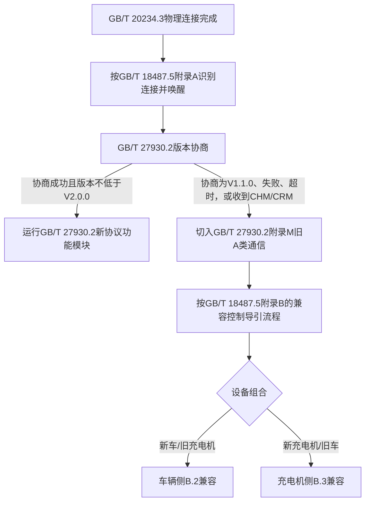

# GB/T 27930—2015、2023、2024 差异及向下兼容流程

> 本文聚焦 GB/T 20234.3 直流接口下的 A 类/旧通信兼容。内容依据工作区 `original-doc/GBT+27930-2015.md`、`original-doc/GBT+27930-2023.md`、`original-doc/GBT+27930.2-2024.md`、`original-doc/GBT+18487.5-2024.md` 整理。实施和符合性判定应以正式标准原文及完整图表为准。

## 1. 先区分协议版本与控制导引版本

- **GB/T 27930—2015**规定旧版 CAN/PGN A 类充电通信，主要阶段为低压辅助上电、CHM/BHM 握手、CRM/BRM 辨识、参数配置、充电、结束统计。
- **GB/T 27930—2023**同时包含 A 类系统和新增的 B 类系统。第 5～11 章为 A 类系统；第 12～17 章为 B 类系统。B 类配套 GB/T 18487.1—2023 附录 C 和 GB/T 20234.4，不要与 2024 年用于 GB/T 20234.3 的 V2.0 新协议混为一谈。
- **GB/T 27930.2—2024**面向 GB/T 20234.3，通信版本不低于 V2.0.0 时运行新功能模块协议；协商失败、超时、协商到 V1.1.0，或车辆在协商阶段收到 CHM/CRM，则进入附录 M 的旧 A 类通信协议。
- **GB/T 18487.5—2024**定义该接口的新控制导引（附录 A）及其旧协议兼容导引（附录 B）。通信回退到旧协议时，还必须按该附录 B 对应的兼容电路和控制流程运行。

简单说，2024 的向下兼容由两部分共同组成：**GB/T 27930.2—2024 附录 M 管旧通信；GB/T 18487.5—2024 附录 B 管旧版导引/辅源/接触器交互。**仅切换 CAN 报文，不足以保证兼容。

## 2. 三版差异总览

| 维度 | GB/T 27930—2015 | GB/T 27930—2023 A 类 | GB/T 27930.2—2024 |
|---|---|---|---|
| 适用/架构 | 充电机与 BMS 之间的 CAN/PGN 通信 | 第 5～11 章延续 A 类；第 12～17 章新增 B 类功能模块协议 | GB/T 20234.3、GB/T 18487.5 导引系统的新版通信；另有附录 M 回退通信 |
| 通信启动 | 物理连接后接通低压辅助电源，发送 CHM/BHM；无 V2.0 版式的显式 CAN 版本协商 | A 类沿用 CHM/BHM、CRM/BRM 握手；B 类新增版本协商机制 | 新流程在物理连接及通信链路建立后立即版本协商；协商结果选择 V2.0+ 新流程或附录 M |
| A 类/兼容通信 | CHM、BHM、CRM、BRM、BCP、CML、BRO、CRO、BCL、BCS、CCS、BST/CST、BSD/CSD 等 PGN | A 类主要沿用同组 PGN，并更新若干条件、字段、超时及开始/结束发送条件 | 附录 M 使用 V1.1.0 A 类报文体系，并规定版本协商如何进入该流程；PGN 流程不是 V2.0 新协议 |
| 新协议 | 无 | 第 12～17 章 B 类系统：版本协商、短/长消息传输、FC/FDC 功能模块 | V2.0.0：版本协商后使用 FC/FDC、PGI 和阶段确认的功能模块通信；物理层/基础帧格式引用 2023 版相应要求 |
| 控制导引关联 | 旧导引：检测点1/2、连接确认、K3/K4 辅源、CHM/BHM 握手，见对应版 GB/T 18487 附录 | A 类配 GB/T 18487.1—2023 附录 B；B 类配附录 C | V2.0 新通信配 GB/T 18487.5—2024 附录 A；附录 M 兼容通信配该标准附录 B |
| 兼容策略 | 标准自身无 V2.0 版本协商 | 2023 B 类与 A 类是同一标准中的不同协议系统，不可只按相同接口推断互通 | V2.0 新通信先协商；进入附录 M 后按旧 A 类通信及 18487.5 附录 B 控制导引继续 |

### 2.1 2015 与 2023 A 类：沿用框架但不等于逐字相同

两者都以 CHM/BHM 握手、CRM/BRM 辨识及 PGN 充电流程为主，硬件连接后的低压辅源及 A 类导引逻辑也延续旧模式。但 2023 前言明确列出流程、报文和发送条件的变化，例如：

- A 类握手及正常充电通信流程有修订；
- BHM/CHM 的停止发送条件、充电中止/错误字段及结束阶段报文条件有调整；
- 2023 A 类明确说明 CHM 可在辅源闭合后 1 s 内发送，并增加相应的兼容处理规定。

因此，旧设备兼容验证不能仅检查 PGN 编号相同；还需核对报文字段、状态判定、时序和结束/重连行为。

### 2.2 2023 B 类与 2024 V2.0：不是同一套导引硬件

GB/T 27930—2023 B 类属于 GB/T 20234.4/GB/T 18487.1—2023 附录 C 生态。GB/T 27930.2—2024 V2.0 面向 GB/T 20234.3/GB/T 18487.5—2024 附录 A。两者可能同用版本协商、功能模块等概念，但物理接口和控制导引电路不同，不能互换 CP 电路、检测点状态或接触器控制。

## 3. 2024 通信及导引分流

### 3.1 新协议与兼容协议的切换条件

- 物理连接完成后双方启动 GB/T 27930.2 版本协商；V2.0.0 及以上协商成功，进入新协议。
- 协商成功为 V1.1.0 时，转附录 M；从首次发送版本协商报文起超过 10 s、协商失败，也按附录 M 处理。
- 车辆在协商期间收到 CHM/CRM，同样进入附录 M。
- 回退后，充电机不能只继续发送版本协商帧等待旧车；应按兼容导引状态，在适当时机接通辅源并发送 CHM/CRM。车辆应等待辅源及 CHM/CRM，再发送旧版握手响应。
- 版本协商数据中含控制导引版本信息，但标准规定接收方不以该字段判定通信版本协商结果；不能用 CPVersion 字段代替协议版本分流，也不能仅凭该字段认定硬件已具备旧导引能力。

## 4. 2024 新车辆兼容旧充电机：车辆侧详细过程

本节对应 **GB/T 18487.5—2024 附录 B.2**：新车辆控制器面对实现旧 A 类充电通信及旧导引的充电机。车辆侧必须具备该兼容电路/状态逻辑，不能只实现附录 A 新导引。

### 4.1 车辆侧兼容电路要点

- 附录 B.2.1.1 的兼容电路包含检测点1、检测点2、检测点3相关网络，车辆侧 R4/R5/R6、常闭开关 S2/S3、车辆断开接触器 K5/K6；辅源及 K3/K4 由充电机提供。
- 表 B.1 规定旧接口连接/状态典型值：检测点1未连接约12 V、插合过程约6 V、完全连接约4 V；检测点3完全连接约4 V；检测点2在 CC2 连接时约为 U2/2（U2示例12 V，可由车辆厂定义且不大于28 V）。
- 表 B.1 另定义兼容状态：检测点1约5.7 V/10.9 V、检测点3约5.7 V/10.9 V等，对应 S、S2 状态。它们是兼容流程新增状态，不应误当成正常的4 V连接状态。
- S3 用于车辆侧兼容控制。车辆闭合 K5/K6 后，在车辆接口电压大于0 V时断开 S3，通过检测点3监测连接；结束/中止时，在 K5/K6 已断开或车辆接口电压绝对值低于60 V后再闭合 S3（A.3.2.7）。

### 4.2 车辆端时序

1. **插枪及不可行驶**：CC2回路导通后使车辆进入不可行驶状态。车辆检测点2达到 U2/2，或检测点3达到4 V时识别连接/唤醒条件。
2. **先进行新版版本协商**：车辆检测点3为4 V时，车辆立即发起 GB/T 27930.2 版本协商。若失败、超时、协商到 V1.1.0，或收到 CHM/CRM，停止新版协商，转旧 A 类兼容通信（B.2.2.2.1、GB/T 27930.2—2024 7.2及附录M）。
3. **等待旧充电机握手**：进入兼容分支后，车辆等待充电机辅源/CHM；收到 CHM 后按周期发送 BHM，提供车辆端绝缘监测允许总电压。之后按旧流程发送 BRM、BCP，并接收 CRM、CML 等。不要在尚未进入兼容分支时把普通的版本协商失败直接解释为任意故障，也不要在兼容握手已开始后继续发 V2.0 功能模块报文。
4. **等待充电机自检及能力**：充电机自检、辨识及参数配置按附录 M 的旧通信流程执行。车辆按旧协议判断参数匹配和是否允许充电；准备就绪后闭合 K5/K6，使车辆供电回路接入。
5. **控制 S3 并监测连接**：K5/K6闭合后，若车辆接口电压大于0 V，断开 S3；利用检测点3监测接口连接及PE相关状态。S3断开后检测点3变为0 V也可能与PE触头断路有关，必须结合检测点2状态按附录B.2判别，不能把单一电压当作唯一故障原因。
6. **能量传输**：按旧 A 类报文发送 BCL/BCS/BSM 等需求和状态信息；车辆监测电流、车辆接口连接、PE及绝缘状态，按兼容要求控制K5/K6。通信由 GB/T 27930.2 附录 M 管理。
7. **正常结束**：车辆发送 BST 等中止/结束信息；在确认电流低于5 A后断开K5/K6，并按 B.2.2.6闭合 S3，使检测点2回到约6 V。车辆按结束流程完成统计报文。未满足附录规定的电压安全条件前，不应恢复可拔枪状态。
8. **紧急/故障停机**：符合 A.3.2.7 时，车辆可断开新版控制导引开关 S2作为紧急停机信号；该动作应使充电机检测到导引状态变化。车辆还要按 B.2.2.7 的要求处理K5/K6及中止报文。兼容电路中的S2/S3不要与附录A正常新协议状态混用。

## 5. 2024 新充电机兼容旧车辆：充电机侧详细过程

本节对应 **GB/T 18487.5—2024 附录 B.3**：实现新版控制器/新版通信能力的充电机面对旧车辆。充电机须支持 B.3 指定的兼容导引电路、K3/K4辅源和旧通信流程。

### 5.1 充电机侧兼容电路要点

- 附录 B.3.1.1规定电路包含充电机上拉及 R1/R2、车辆插头 R3、车辆侧 R4/R5、车辆插头常闭开关S、充电机常闭兼容开关S1、K1/K2主接触器、K3/K4低压辅源接触器及车辆K5/K6。
- 表 B.3参数：充电机 R1=2 kΩ、R2=3 kΩ、U1约12 V；车辆插头/车辆侧电阻约1 kΩ。检测点1未连接约12 V、完全连接约4 V、完全连接且兼容S1断开约2 V；车辆检测点2在CC2未连接约12 V、连接约6 V。
- 辅源测量点在车辆插头触头，额定12 V±1.8 V、额定电流10 A。充电机应控制并监测K3/K4及K1/K2；不能将K3/K4的辅源控制与K1/K2的直流主回路控制合并处理。
- 兼容电路S1是旧导引的常闭控制开关；正常兼容充电保持其闭合，按规定断开可改变检测点1状态并触发车辆停机。它不同于 GB/T 18487.5 附录A新导引电路中名称相同、用于新版状态机的S1。

### 5.2 充电机端时序

1. **插枪确认**：检测点1达到4 V时确认车辆接口完全连接，立即开始 GB/T 27930.2 版本协商（B.3.2.2.1）。此时仍处于新版导引/协商阶段，不要提前把K1/K2闭合或提前当作旧握手阶段。
2. **协议回退判定**：若版本协商失败、超时或成功版本为 V1.1.0，按 GB/T 27930.2 附录M及18487.5附录B.3进入兼容流程。若协商成功为V2.0.0及以上，则留在附录A新导引及新协议流程。
3. **授权、锁止、辅源**：兼容分支下，充电机导引开关S1保持闭合（A.3.2.7）；在充电启动条件满足后锁止电子锁，闭合K3/K4，向车辆插头提供规定辅源；开始周期发送CHM。附录M要求辅源闭合后1 s内发送首帧CHM，CHM按250 ms周期发送。不要以新版功能协商或阶段确认报文替代CHM/BHM握手。
4. **握手及自检**：接收旧车BHM后，按兼容流程进行K1/K2外侧电压检查、接触器故障/粘连检查、短路和绝缘检测。绝缘自检按B.3.2.3规定闭合K1/K2施加检测电压，完成后物理切出IMD并投切泄放；电压降至规定安全值后断开K1/K2。完成自检后停止CHM、发送CRM并进入BRM/BCP等旧协议辨识和参数配置。
5. **准备就绪及预充**：发送CML等充电能力；收到车辆准备就绪并核对车辆电压/充电参数后，按B.3.2.4执行预充，K1/K2按车辆接口电压减1 V～10 V的要求投入主回路。绝缘检测/泄放与正常充电主回路投入次序应遵循附录B.3，避免误把新协议输出回路检测时序直接套入旧车兼容流程。
6. **能量传输**：按附录M发送/接收旧 A 类充电报文并依据车辆需求调节输出。监视检测点1：完全连接约4 V；连接不可靠超出表B.3的 U1b范围时，发送中止信息，30 ms内降至5 A及以下、100 ms内断开K1/K2/K3/K4（B.3.2.7.1）。
7. **正常结束**：按旧协议完成BST/CST及BSD/CSD统计交互；将输出电流降至5 A及以下后断开K1/K2并泄放。K3/K4应按兼容流程在统计交互结束后断开，不应在需要BMS完成统计报文前切断辅源。电子锁在车辆接口电压降至规定安全电压后解锁。
8. **故障与通信超时**：通信超时及重连按 GB/T 27930.2 附录M和18487.5 B.3.2.7.3执行；连接异常、绝缘/短路/粘连故障按B.3.2.7处理。若需重连，应先满足K1/K2外侧电压小于60 V等条件。不得直接套用V2.0新协议的阶段确认、错误类别或重连状态机。

## 6. 两种兼容方向的关键动作对照

| 时点/功能 | 新车辆兼容旧充电机（18487.5 B.2） | 新充电机兼容旧车辆（18487.5 B.3） |
|---|---|---|
| 版本协商发起 | 车辆检测点3=4 V后开始；充电机检测点1=4 V后开始 | 充电机检测点1=4 V后开始；车辆检测点2约6 V识别连接，按旧流程等待握手 |
| 回退后通信 | 车辆停止V2.0功能模块流程，等待旧充电机辅源/CHM，再发BHM/BRM等 | 充电机停止V2.0功能模块流程，闭合K3/K4并发CHM，按旧A类PGN继续 |
| 导引控制重点 | 新车实现旧车可识别的兼容电阻/状态；K5/K6闭合后按条件断开S3并监测检测点3；结束后恢复S3 | 充电机提供B.3旧车可识别的电阻网络/检测点状态；正常闭合兼容S1；控制K3/K4辅源和K1/K2主回路 |
| 需要额外控制 | 新控制器不能把收到旧CHM误判为V2通信数据；需执行旧流程的PE/连接监测及停机 | 辅源供电、CHM定时发送、旧自检/泄放/锁止及旧统计结束流程 |
| 主要规范条款 | GB/T 18487.5—2024 B.2.1～B.2.4、A.3.2.7；GB/T 27930.2—2024 附录M | GB/T 18487.5—2024 B.3.1～B.3.4；GB/T 27930.2—2024 附录M |

## 7. 容易混淆的事项

1. **V2.0版本协商与旧协议握手是两个阶段。**前者用2024版本协商报文决定协议分支；后者是回退后由辅源、CHM/BHM等组成的旧 A 类握手。
2. **新导引 S1、旧兼容 S1不是同一语义。**新导引S1属于附录A状态机；B.3的常闭S1属于旧式充电机兼容导引，按B.3状态控制。设计/软件命名时宜区分信号名，避免误驱动。
3. **K3/K4是辅源，不是K1/K2主回路。**旧通信启动、唤醒及结束统计阶段依赖辅源；主回路须按自检、泄放、预充、能量传输及停机条件独立控制。
4. **V1.1.0是明确的兼容版本例子，不应将所有版本协商失败都处理为无条件继续充电。**附录M规范了向下兼容通信，18487.5附录B规定控制导引兼容动作；失败/超时仍须依据两份标准规定的分支、故障和退出条件处理。
5. **不要仅凭报文PGN相同认定互通。**2015、2023 A类及2024附录M总体沿用A类报文体系，但字段、条件、错误处理、结束统计时序有变化；以具体协商分支所引用的版本及附录为准。

## 8. 原文依据

- GB/T 27930—2015：第8章、第9.1章、第10.1章、附录A。
- GB/T 27930—2023：第1章、第5～11章（A类）、第12～17章（B类）、第14.5章、附录A和附录B。
- GB/T 27930.2—2024：第5.7～5.8条、第7.2条、附录M（特别是M.1、M.5～M.8）。
- GB/T 18487.5—2024：第5.1.4条、附录A A.3.2.7、附录B B.1～B.4。
