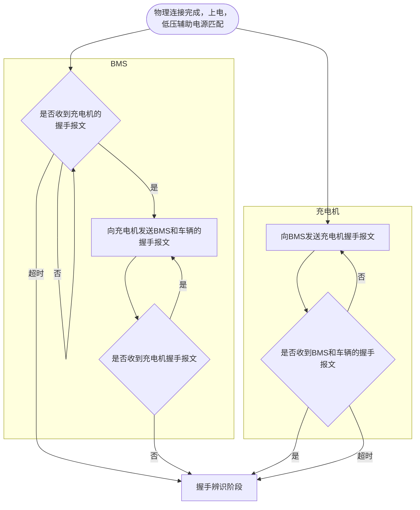
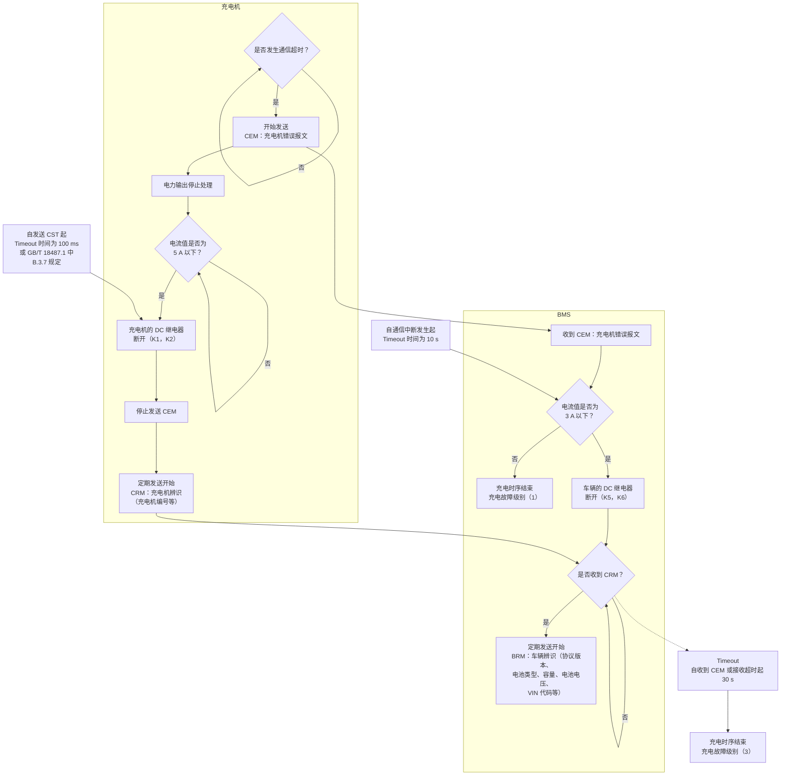
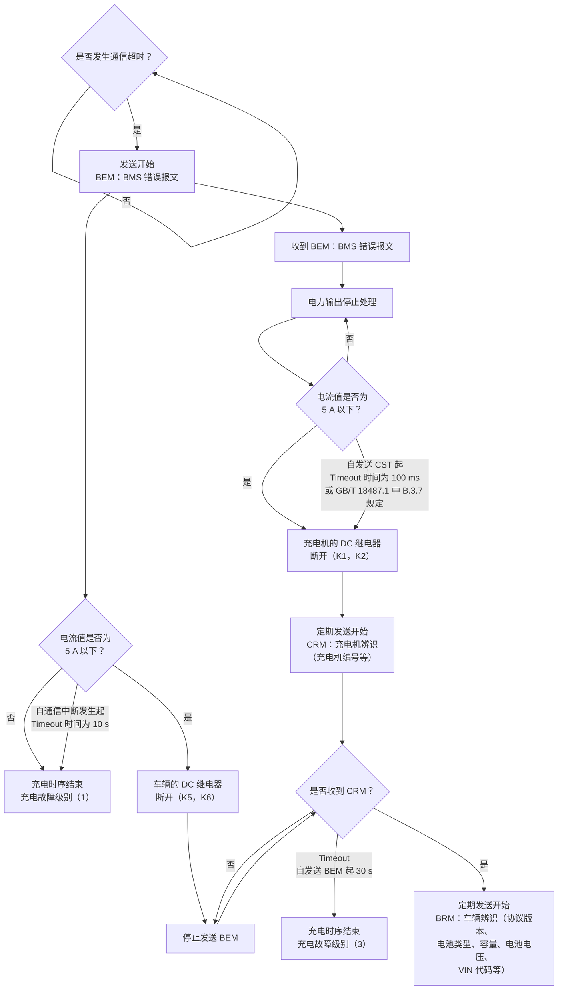

<!-- Page 1 -->

ICS 29.200  
K 81

# GB/T 27930—2015

代替 GB/T 27930—2011

# 电动汽车非车载传导式充电机与电池管理系统之间的通信协议

**Communication protocols between off-board conductive charger and battery management system for electric vehicle**

2015-12-28 发布  
2016-01-01 实施

中华人民共和国国家质量监督检验检疫总局  
中国国家标准化管理委员会 发布


<!-- Page 2 -->

# 目录

| 条目 | 页码 |
|---|---:|
| 前言 | Ⅲ |
| 1 范围 | 1 |
| 2 规范性引用文件 | 1 |
| 3 术语和定义 | 1 |
| 4 总则 | 2 |
| 5 物理层 | 3 |
| 6 数据链路层 | 3 |
| 7 应用层 | 4 |
| 8 充电总体流程 | 5 |
| 9 报文分类 | 5 |
| 10 报文格式和内容 | 7 |
| 附录 A（资料性附录）充电流程 | 21 |
| 附录 B（资料性附录）充电机和 BMS 故障诊断报文 | 38 |
| 附录 C（资料性附录）充电过程故障处理方式 | 41 |
| 附录 D（资料性附录）报文开始发送条件和中止发送条件 | 43 |


<!-- Page 3 -->

# 前言

本标准按照 GB/T 1.1—2009 给出的规则起草。

本标准代替 GB/T 27930—2011《电动汽车非车载传导式充电机与电池管理系统之间的通信协议》。与 GB/T 27930—2011 相比，除编辑性修改外主要技术变化如下：

- 规定了“执行本标准的充电机和 BMS 宜具备向前兼容性”见 4.6；
- 通信环境恶劣的情况增加 50 kbit/s 的通信速率（见第 5 章）；
- 规定了“可选项所有位按照本标准规定格式发送或填充 1，本标准未规定的无效位或字段填充 1”（见 7.9）；
- 修改了总体流程图（见第 8 章）；
- 增加通信握手报文 BHM 和 CHM（见 9.1）；
- BRM 增加 8 个字节用于预留（见 10.1.4）；
- CML 增加最小充电电流字段（见 10.2.3）；
- CCS 增加充电暂停字段（见 10.3.3）；
- 增加 BMS 中止充电故障原因（见 10.3.8）；
- 增加充电时序流程图（见 A.2）；
- 增加充电过程故障处理方式（见附录 C）；
- 增加报文开始发送条件和中止发送条件（见附录 D）。

本标准由中国电力企业联合会提出并归口。

本标准负责起草单位：国家电网公司、中国能源建设集团广东省电力设计研究院有限公司、南京南瑞集团公司、中国汽车技术研究中心。

本标准参加起草单位：中国电力企业联合会、许继集团有限公司、中国电力科学研究院、深圳奥特迅电力设备股份有限公司、比亚迪汽车工业有限公司、比亚迪戴姆勒新技术有限公司、上海汽车集团股份有限公司、普天新能源有限责任公司、中国电器科学研究院、上海电器科学研究院。

本标准主要起草人：沈建新、刘永东、武斌、吾峥明、张雪焱、孟祥峰、倪峰、董新生、李志刚、史双龙、周荣、王洪军、王治成、邓晓光、徐寅、吕国伟、李新强、耿群锋、戴敏、邵浙海、李晓强、马建伟、李彩生、孟凡提、夏露。

本标准所代替标准的历次版本发布情况为：

- GB/T 27930—2011。


<!-- Page 4 -->

# 电动汽车非车载传导式充电机与电池管理系统之间的通信协议

## 1 范围

本标准规定了电动汽车非车载传导式充电机（以下简称充电机）与电池管理系统（Battery Management System，以下简称 BMS）之间基于控制器局域网（Control Area Network，以下简称 CAN）的通信物理层、数据链路层及应用层的定义。

本标准适用于采用 GB/T 18487.1 规定的充电模式 4 的充电机与 BMS 之间的通信，也适用于充电机与具有充电控制功能的车辆控制单元之间的通信。

## 2 规范性引用文件

下列文件对于本文件的应用是必不可少的。凡是注日期的引用文件，仅注日期的版本适用于本文件。凡是不注日期的引用文件，其最新版本（包括所有的修改单）适用于本文件。

- GB/T 19596　电动汽车术语
- GB/T 18487.1　电动车辆传导充电系统—一般要求
- ISO 11898-1:2003　道路车辆控制器局域网络　第 1 部分：数据链路层和物理信令 [Road vehicle—Control area network (CAN) Part 1: Data link layer and physical signaling]
- SAE J1939-11:2006　商用车控制系统局域网 CAN 通信协议　第 11 部分：物理层，250 K 比特/秒，屏蔽双绞线 (Recommended practice for serial control and communication vehicle network—Part 11: Physical layer—250 K bits/s, twisted shielded pair)
- SAE J1939-21:2006　商用车控制系统局域网 CAN 通信协议　第 21 部分：数据链路层 (Recommended practice for serial control and communication vehicle network—Part 21: Data link layer)
- SAE J1939-73:2006　商用车控制系统局域网 CAN 通信协议　第 73 部分：应用层　诊断 (Recommended practice for serial control and communication vehicle network—Part 73: Application Layer—Diagnostics)

## 3 术语和定义

GB/T 19596、SAE J1939 界定的以及下列术语和定义适用于本文件。

### 3.1

**帧** *frame*

组成一个完整信息的一系列数据位。

### 3.2

**CAN 数据帧** *CAN data frame*

用于传输数据的 CAN 协议所必需的有序位域，以帧起始（SOF）开始，帧结束（EOF）结尾。


<!-- Page 5 -->

### 3.3 报文 messages

一个或多个具有相同参数组编号的“CAN 数据帧”。

### 3.4 标识符 identifier

CAN 仲裁域的标识部分。

### 3.5 标准帧 standard frame

CAN2.0B 规范中定义的使用 11 位标识符的 CAN 数据帧。

### 3.6 扩展帧 extended frame

CAN2.0B 规范中定义的使用 29 位标识符的 CAN 数据帧。

### 3.7 优先权 priority

在标识符中一个 3 位的域，设置传输过程的仲裁优先级，最高优先权为 0 级，最低优先权为 7 级。

### 3.8 参数组 parameter group; PG

在一报文中传送参数的集合。

### 3.9 参数组编号 parameter group number; PGN

用于唯一标识一个参数组的一个 24 位值。参数组编号包括：保留位、数据页、PDU 格式域（8 位）、PDU 特定域（8 位）。

### 3.10 可疑参数编号 suspect parameter number; SPN

应用层通过参数描述信号，给每个参数分配的一个 19 位值。

### 3.11 协议数据单元 protocol data unit; PDU

一种特定的 CAN 数据帧格式。

### 3.12 传输协议 transport protocol

数据链路层的一部分，为传送数据 9～1 785 字节的 PGN 提供的一种机制。

### 3.13 电子控制单元 electronic control unit; ECU

电子控制单元，即车载电脑，由微控制器和外围电路组成。

### 3.14 诊断故障代码 diagnostic trouble code; DTC

一种用于识别故障类型、相关故障模式以及发生次数的 4 字节数值。

## 4 总则

### 4.1

充电机与 BMS 之间通信网络采用 CAN2.0B 通信协议。充电流程参见附录 A。

### 4.2

在充电过程中，充电机和 BMS 监测电压、电流和温度等参数，同时 BMS 管理整个充电过程。

### 4.3

充电机与 BMS 之间的 CAN 通信网络应由充电机和 BMS 两个节点组成。


<!-- Page 6 -->

4.4　数据信息传输采用低字节先发送的格式。

4.5　正的电流值代表放电，负的电流值代表充电。

4.6　执行本标准的充电机和 BMS 宜具备向前兼容性。

## 5　物理层

采用本标准的物理层应符合 ISO 11898-1:2003、SAE J1939-11:2006 中关于物理层的规定。本标准充电机与 BMS 的通信应使用独立于动力总成控制系统之外的 CAN 接口。充电机与 BMS 之间的通信速率采用 250 kbit/s。

**注：**在通信环境恶劣的专用场合（如通信距离较长的商用车充电站），经供电设备制造商和电动汽车制造商协商一致，可采用 50 kbit/s 通信速率。

## 6　数据链路层

### 6.1　帧格式

采用本标准的设备应使用 CAN 扩展帧的 29 位标识符，具体每个位分配的相应定义应符合 SAE J1939-21:2006 中的相关规定。

### 6.2　协议数据单元（PDU）

每个 CAN 数据帧包含一个单一的协议数据单元（PDU），见表 1。协议数据单元由七部分组成，分别是优先权、保留位、数据页、PDU 格式、PDU 特定、源地址和数据域。

**表 1　协议数据单元（PDU）**

| 字段 | P | R | DP | PF | PS | SA | DATA |
|---|---:|---:|---:|---:|---:|---:|---:|
| 位数 | 3 | 1 | 1 | 8 | 8 | 8 | 0～64 |

数据格式要求：

1. P 为优先权：从最高 0 设置到最低 7。
2. R 为保留位：备今后开发使用，本标准设为 0。
3. DP 为数据页：用来选择参数组描述的辅助页，本标准设为 0。
4. PF 为 PDU 格式：用来确定 PDU 的格式，以及数据域对应的参数组编号。
5. PS 为 PDU 特定格式：PS 值取决于 PDU 格式。在本标准中采用 PDU1 格式，PS 值为目标地址。
6. SA 为源地址：发送此报文的源地址。
7. DATA 为数据域：若给定参数组数据长度≤8 字节，按照第 9 章规定的报文长度进行传输。若给定参数组数据长度为 9～1 785 字节时，数据传输需多个 CAN 数据帧，通过传输协议功能的连接管理能力来建立和关闭多包参数组的通信，详见 6.5 的规定。
8. 本表第三行表示位数。

### 6.3　协议数据单元（PDU）格式

选用 SAE J1939-21:2006 中定义的 PDU1 格式。

### 6.4　参数组编号（PGN）

PGN 的第二个字节为 PDU 格式（PF）值，高字节和低字节位均为 00H。


<!-- Page 7 -->

## 6.5 传输协议功能

BMS 与充电机之间传输 9～1 785 字节的数据使用传输协议功能。连接初始化、数据传输、连接关闭应遵循 SAE J1939-21:2006 中 5.4.7 和 5.10 消息传输的规定。对于多帧报文，报文周期为整个数据包的发送周期。

## 6.6 地址的分配

网络地址用于保证信息标识符的唯一性以及表明信息的来源。充电机和 BMS 定义为不可配置地址，即该地址固定在 ECU 的程序代码中，包括服务工具在内的任何手段都不能改变其源地址。充电机和 BMS 分配的地址如表 2 所示。

**表 2　充电机和 BMS 地址分配**

| 装置 | 首选地址 |
|---|---|
| 充电机 | 86（56H） |
| BMS | 244（F4H） |

## 6.7 信息类型

CAN 总线技术规范支持五种类型的信息，分别为命令、请求、广播/响应、确认和组功能。具体定义应遵循 SAE J1939-21:2006 中 5.4 信息类型的规定。

# 7 应用层

7.1　应用层采用参数和参数组定义的形式。

7.2　采用 PGN 对参数组进行编号，各个节点根据 PGN 来识别数据包的内容。

7.3　使用“请求 PGN”来主动获取其他节点的参数组。

7.4　采用周期发送和事件驱动的方式来发送数据。

7.5　如果需发送多个 PGN 数据来实现一个功能的，需同时收到该定义的多个 PGN 报文才判断此功能发送成功。

7.6　定义新的参数组时，尽量将相同功能的参数、相同或相近刷新频率的参数和属于同一个子系统内的参数放在同一个参数中；同时，新的参数组既要充分利用 8 个字节的数据宽度，尽量将相关的参数放在同一个组内，又要考虑扩展性，预留一部分字节或位，以便将来进行修改。

7.7　修改第 9 章已定义的参数组时，不应对已定义的字节或位的定义进行修改；新增加的参数要与参数组中原有的参数相关，不应为节省 PGN 的数量而将不相关的参数加入到已定义的 PGN 中。

7.8　充电过程中充电机和 BMS 各种故障诊断定义应遵循 SAE J1939-73:2006 的 5.1 中 CAN 总线诊断系统的要求，附录 B 给出了故障诊断报文定义规范。

7.9　报文选项分为必须项和可选项，对于同一帧报文中全部内容为可选项的，该报文可以选择不发送；对于同一帧报文中部分内容为可选项的，可选项所有位按照本标准规定格式发送或填充 1，本标准未规定的无效位或字段填充 1。本标准未规定的位或预留位填充 1。

7.10　报文的长度和必须项内容及格式需按照第 10 章中规定发送。


<!-- Page 8 -->

## 8 充电总体流程

整个充电过程包括六个阶段：物理连接完成、低压辅助上电、充电握手阶段、充电参数配置阶段、充电阶段和充电结束阶段。在各个阶段，充电机和 BMS 如果在规定的时间内没有收到对方报文或没有收到正确报文，即判定为超时（超时指在规定时间内没有收到对方的完整数据包或正确数据包），超时时间除特殊规定外，均为 5 s。当出现超时后，BMS 或充电机发送 9.5 规定的错误报文，并进入错误处理状态。在对故障处理的过程中，根据故障的类别，分别进行不同的处理（参见附录 C）。在充电结束阶段中，如果出现了故障，直接结束充电流程。报文的开始发送条件和中止发送条件参见附录 D。充电总体流程见图 1。

```text
物理连接完成
    ↓
低压辅助上电
    ↓
充电握手阶段
    ↓
充电参数配置阶段
    ↓
充电阶段
    ↓
充电结束阶段
    ↓
结束充电
```

**图 1 充电总体流程图**

## 9 报文分类

### 9.1 低压辅助上电及充电握手阶段

充电握手阶段分为握手启动阶段和握手辨识阶段，当充电机和 BMS 物理连接完成并上电后，开启低压辅助电源，进入握手启动阶段发送握手报文，再进行绝缘监测。绝缘监测结束后进入握手辨识阶段，双方发送辨识报文，确定电池和充电机的必要信息。CHM 报文和 BHM 报文是为产品兼容的新增报文，用于在握手启动阶段充电机和 BMS 判断双方使用的标准版本。典型的充电工作状态转换参见图 A.1 和图 A.2，充电时序详见 GB/T 18487.1。充电握手阶段报文应符合表 3 的要求。

**表 3 充电握手阶段报文分类**

| 报文代号 | 报文描述 | PGN（Dec） | PGN（Hex） | 优先权 | 数据长度 byte | 报文周期 ms | 源地址-目的地址 |
|---|---|---:|---|---:|---:|---:|---|
| CHM | 充电机握手 | 9728 | 002600H | 6 | 3 | 250 | 充电机-BMS |
| BHM | 车辆握手 | 9984 | 002700H | 6 | 2 | 250 | BMS-充电机 |


<!-- Page 9 -->

表 3（续）

| 报文代号 | 报文描述 | PGN（Dec） | PGN（Hex） | 优先权 | 数据长度（byte） | 报文周期（ms） | 源地址-目的地址 |
|---|---|---:|---|---:|---:|---:|---|
| CRM | 充电机辨识 | 256 | 000100H | 6 | 8 | 250 | 充电机-BMS |
| BRM | BMS 和车辆辨识报文 | 512 | 000200H | 7 | 41 | 250 | BMS-充电机 |

## 9.2 充电参数配置阶段

充电握手阶段完成后，充电机和 BMS 进入充电参数配置阶段。在此阶段，充电机向 BMS 发送充电机最大输出能力的报文，BMS 根据充电机最大输出能力判断是否能够进行充电。典型的充电工作状态转换参见图 A.3。充电参数配置阶段报文应符合表 4 的要求。

**表 4　充电参数配置阶段报文分类**

| 报文代号 | 报文描述 | PGN（Dec） | PGN（Hex） | 优先权 | 数据长度（byte） | 报文周期（ms） | 源地址-目的地址 |
|---|---|---:|---|---:|---:|---:|---|
| BCP | 动力蓄电池充电参数 | 1536 | 000600H | 7 | 13 | 500 | BMS-充电机 |
| CTS | 充电机发送时间同步信息 | 1792 | 000700H | 6 | 7 | 500 | 充电机-BMS |
| CML | 充电机最大输出能力 | 2048 | 000800H | 6 | 8 | 250 | 充电机-BMS |
| BRO | 电池充电准备就绪状态 | 2304 | 000900H | 4 | 1 | 250 | BMS-充电机 |
| CRO | 充电机输出准备就绪状态 | 2560 | 000A00H | 4 | 1 | 250 | 充电机-BMS |

## 9.3 充电阶段

充电配置阶段完成后，充电机和 BMS 进入充电阶段。在整个充电阶段，BMS 实时向充电机发送电池充电需求，充电机根据电池充电需求来调整充电电压和充电电流以保证充电过程正常进行。在充电过程中，充电机和 BMS 相互发送各自的充电状态。除此之外，BMS 根据要求向充电机发送动力蓄电池具体状态信息及电压、温度等信息。BMV、BMT、BSP 为可选报告，充电机不对其进行报文超时判定。

BMS 根据充电过程是否正常、电池状态是否达到 BMS 自身设定的充电结束条件以及是否收到充电机中止充电报文（包括具体中止原因、报文参数值全为 0 和不可信状态）来判断是否结束充电；充电机根据是否收到停止充电指令、充电过程是否正常、是否达到人为设定的充电参数值，或者是否收到 BMS 中止充电报文（包括具体中止原因、报文参数值全为 0 和不可信状态）来判断是否结束充电。典型的充电工作状态转换参见图 A.4。充电阶段报文应符合表 5 的要求。

**表 5　充电阶段报文分类**

| 报文代号 | 报文描述 | PGN（Dec） | PGN（Hex） | 优先权 | 数据字节（byte） | 报文周期 | 源地址-目的地址 |
|---|---|---:|---|---:|---:|---|---|
| BCL | 电池充电需求 | 4096 | 001000H | 6 | 5 | 50 ms | BMS-充电机 |
| BCS | 电池充电总状态 | 4352 | 001100H | 7 | 9 | 250 ms | BMS-充电机 |
| CCS | 充电机充电状态 | 4608 | 001200H | 6 | 8 | 50 ms | 充电机-BMS |
| BSM | 动力蓄电池状态信息 | 4864 | 001300H | 6 | 7 | 250 ms | BMS-充电机 |


<!-- Page 10 -->

**表 5（续）**

| 报文代号 | 报文描述 | PGN（Dec） | PGN（Hex） | 优先权 | 数据字节 byte | 报文周期 | 源地址-目的地址 |
|---|---|---:|---|---:|---|---|---|
| BMV | 单体动力蓄电池电压 | 5376 | 001500H | 7 | 不定 | 10 s | BMS-充电机 |
| BMT | 动力蓄电池温度 | 5632 | 001600H | 7 | 不定 | 10 s | BMS-充电机 |
| BSP | 动力蓄电池预留报文 | 5888 | 001700H | 7 | 不定 | 10 s | BMS-充电机 |
| BST | BMS 中止充电 | 6400 | 001900H | 4 | 4 | 10 ms | BMS-充电机 |
| CST | 充电机中止充电 | 6656 | 001A00H | 4 | 4 | 10 ms | 充电机-BMS |

### 9.4 充电结束阶段

当充电机和 BMS 停止充电后，双方进入充电结束阶段。在此阶段 BMS 向充电机发送整个充电过程中的充电统计数据，包括：初始 SOC、终于 SOC、电池最低电压和最高电压；充电机收到 BMS 的充电统计数据后，向 BMS 发送整个充电过程中的输出电量、累计充电时间等信息，最后停止低压辅助电源的输出。典型的充电工作状态转换参见图 A.5。充电结束阶段报文应符合表 6 的要求。

**表 6　充电结束阶段报文分类**

| 报文代号 | 报文描述 | PGN（Dec） | PGN（Hex） | 优先权 | 数据字节 byte | 报文周期 ms | 源地址-目的地址 |
|---|---|---:|---|---:|---:|---:|---|
| BSD | BMS 统计数据 | 7168 | 001C00H | 6 | 7 | 250 | BMS-充电机 |
| CSD | 充电机统计数据 | 7424 | 001D00H | 6 | 8 | 250 | 充电机-BMS |

### 9.5 错误报文

在整个充电阶段，当 BMS 或充电机检测到存在错误时，发送错误报文。错误报文应符合表 7 的要求。

**表 7　错误报文分类**

| 报文代号 | 报文描述 | PGN（Dec） | PGN（Hex） | 优先权 | 数据字节 byte | 报文周期 ms | 源地址-目的地址 |
|---|---|---:|---|---:|---:|---:|---|
| BEM | BMS 错误报文 | 7680 | 001E00H | 2 | 4 | 250 | BMS-充电机 |
| CEM | 充电机错误报文 | 7936 | 001F00H | 2 | 4 | 250 | 充电机-BMS |

## 10 报文格式和内容

### 10.1 低压辅助上电及充电握手阶段报文

#### 10.1.1 PGN9728 充电机握手报文（CHM）

报文功能：当充电机和电动汽车物理连接并完成上电，且电压检测正常后，由充电机向 BMS 每隔 250 ms 发送一次充电机握手报文，用于确定双方是否握手正常。PGN9728 报文格式见表 8。


<!-- Page 11 -->

**表 8　PGN9728 报文格式**

| 起始字节或位 | 长度 | SPN | SPN 定义 | 发送选项 |
|---|---:|---:|---|---|
| 1 | 3 字节 | 2600 | 充电机通信协议版本号，本标准规定当前版本为 V1.1，表示为：byte3，byte2—0001H；byte1—01H | 必须项 |

### 10.1.2　PGN9984 BMS 握手报文（BHM）

报文功能：当 BMS 收到 PGN9984 充电机握手报文后，向充电机每隔 250 ms 返回 BMS 握手报文，提供 BMS 最高允许充电总电压。PGN9984 报文格式见表 9。

**表 9　PGN9984 报文格式**

| 起始字节或位 | 长度 | SPN | SPN 定义 | 发送选项 |
|---|---:|---:|---|---|
| 1 | 2 字节 | 2601 | 最高允许充电总电压 | 必须项 |

其中：

SPN2601 最高输出电压（V）；

数据分辨率：0.1 V／位，0 V 偏移量。

### 10.1.3　PGN256 充电机辨识报文（CRM）

报文功能：当充电机通过握手确认，并确定绝缘检测正常后，使用 250 kbit/s 通信速率向 BMS 每隔 250 ms 发送一次充电机辨识报文，用于确认充电机和 BMS 之间通信链路正确。在收到 BMS 辨识报文前，确认码＝0x00；在收到车载充电机辨识报文后，确认码＝0xAA。PGN256 报文格式见表 10。

**表 10　PGN256 报文格式**

| 起始字节或位 | 长度 | SPN | SPN 定义 | 发送选项 |
|---|---:|---:|---|---|
| 1 | 1 字节 | 2560 | 辨识结果，（＜0x00＞：= BMS 不能辨识；＜0xAA＞：= BMS 能辨识） | 必须项 |
| 2 | 4 字节 | 2561 | 充电机编号，1/位，0 偏移量，数据范围：0～0xFFFFFFFF | 必须项 |
| 6 | 3 字节 | 2562 | 充电机/充电站所在区域编码，标准 ASCII 码 | 可选项 |

### 10.1.4　PGN512 BMS 和车辆辨识报文（BRM）

报文功能：充电握手阶段向充电机提供 BMS 和车辆辨识信息。当 BMS 收到 SPN2560＝0x00 的充电机辨识报文后向充电机每隔 250 ms 发送一次，数据域长度超出 8 字节时，需使用传输协议功能传输，格式详见 6.5 的规定，发送间隔为 10 ms，直到在 5 s 内收到 SPN2560＝0xAA 的充电机辨识报文为止。PGN512 报文格式见表 11。


<!-- Page 12 -->

## 表 11　PGN512 报文格式

| 起始字节或位 | 长度 | SPN | SPN 定义 | 发送选项 |
|---|---:|---:|---|---|
| 1 | 3 字节 | 2565 | BMS 通信协议版本号，本标准规定当前版本为 V1.1，表示为：byte3, byte2—0001H；byte1—01H | 必须项 |
| 4 | 1 字节 | 2566 | 电池类型，01H：铅酸电池；02H：镍氢电池；03H：磷酸铁锂电池；04H：锰酸锂电池；05H：钴酸锂电池；06H：三元材料电池；07H：聚合物锂离子电池；08H：钛酸锂电池；FFH：其他电池 | 必须项 |
| 5 | 2 字节 | 2567 | 整车动力蓄电池系统额定容量/Ah，0.1 Ah/位，0 Ah 偏移量 | 必须项 |
| 7 | 2 字节 | 2568 | 整车动力蓄电池系统额定总电压/V，0.1 V/位，0 V 偏移量 | 必须项 |
| 9 | 4 字节 | 2569 | 电池生产厂商名称，标准 ASCII 码 | 可选项 |
| 13 | 4 字节 | 2570 | 电池组序号，预留，由厂商自行定义 | 可选项 |
| 17 | 1 字节 |  | 电池组生产日期：年，1 年/位，1985 年偏移量，数据范围：1985～2235 年 | 可选项 |
| 18 | 1 字节 |  | 电池组生产日期：月，1 月/位，0 月偏移量，数据范围：1～12 月 | 可选项 |
| 19 | 1 字节 |  | 电池组生产日期：日，1 日/位，0 日偏移量，数据范围：1～31 日 | 可选项 |
| 20 | 3 字节 | 2572 | 电池组充电次数，1 次/位，0 次偏移量，以 BMS 统计为准 | 可选项 |
| 23 | 1 字节 | 2573 | 电池组产权标识（\<0\>：=租赁；\<1\>：=车自有） | 可选项 |
| 24 | 1 字节 | 2574 | 预留 | 可选项 |
| 25 | 17 字节 | 2575 | 车辆识别码（VIN） | 可选项 |
| 42 | 8 字节 | 2576 | BMS 软件版本号 8 字节表示当前 BMS 版本信息，按照 16 进制编码确定。其中：<br><br>Byte8、byte7、byte6—000001H～FFFFFFH，预留，填写 FFFFFFH；<br><br>Byte5-byte2 作为 BMS 软件版本编译时间信息标记，<br><br>Byte5, byte4—0001H～FFFEH 表示“年”（例如 2015 年：填写 Byte5—DFH，byte4—07H）；<br><br>Byte3—01H～0CH 表示“月”（例如 11 月：填写 Byte3—0BH）；<br><br>Byte2—01H～1FH 表示“日”（例如 10 日：填写 Byte2—0AH）；<br><br>Byte1—01H～FEH 表示版本流水号（例如 16：填写 Byte1—10H）。<br><br>（如上数值表示：BMS 当前使用 2015 年 11 月 10 日第 16 次编译版本，未填写认证授权码） | 可选项 |


<!-- Page 13 -->

## 10.2 参数配置阶段报文

### 10.2.1 PGN1536 动力蓄电池充电参数报文（BCP）

报文功能：充电参数配置阶段 BMS 发送给充电机的动力蓄电池充电参数。如果充电机在 5 s 内没有收到该报文，即为超时错误，充电机应立即结束充电。PGN1536 报文格式见表 12。

**表 12　PGN1536 报文格式**

| 起始字节或位 | 长度 | SPN | SPN 定义 | 发送选项 |
|---|---|---:|---|---|
| 1 | 2 字节 | 2816 | 单体动力蓄电池最高允许充电电压 | 必须项 |
| 3 | 2 字节 | 2817 | 最高允许充电电流 | 必须项 |
| 5 | 2 字节 | 2818 | 动力蓄电池标称总能量 | 必须项 |
| 7 | 2 字节 | 2819 | 最高允许充电总电压 | 必须项 |
| 9 | 1 字节 | 2820 | 最高允许温度 | 必须项 |
| 10 | 2 字节 | 2821 | 整车动力蓄电池荷电状态 | 必须项 |
| 12 | 2 字节 | 2822 | 整车动力蓄电池当前电池电压 | 必须项 |

其中：

1）SPN2816 单体动力蓄电池最高允许充电电压  
数据分辨率：0.01 V/位，0 V 偏移量；数据范围：0～24 V；

2）SPN2817 最高允许充电电流  
数据分辨率：0.1 A/位，−400 A 偏移量；

3）SPN2818 动力蓄电池标称总能量  
数据分辨率：0.1 kW·h/位，0 kW·h 偏移量；数据范围：0～1 000 kW·h；

4）SPN2819 最高允许充电总电压  
数据分辨率：0.1 V/位，0 V 偏移量；

5）SPN2820 最高允许动力蓄电池温度  
数据分辨率：1 ℃/位，−50 ℃ 偏移量；数据范围：−50 ℃～＋200 ℃；

6）SPN2821 整车动力蓄电池荷电状态（SOC）  
数据分辨率：0.1 %/位，0 % 偏移量；数据范围：0～100 %；

7）SPN2822 整车动力蓄电池总电压  
数据分辨率：0.1 V/位，0 V 偏移量。

### 10.2.2 PGN1792 充电机发送时间同步信息报文（CTS）

报文功能：充电参数配置阶段充电机发送给 BMS 的时间同步信息。PGN1792 报文格式见表 13。

**表 13　PGN1792 报文格式**

| 起始字节或位 | 长度 | SPN | SPN 定义 | 发送选项 |
|---|---|---:|---|---|
| 1 | 7 字节 | 2823 | 年/月/日/时/分/秒 | 可选项 |

其中，SPN2823 日期/时间

第 1 字节：秒（压缩 BCD 码）；第 2 字节：分（压缩 BCD 码）；


<!-- Page 14 -->

第 3 字节：时（压缩 BCD 码）；第 4 字节：日（压缩 BCD 码）；

第 5 字节：月（压缩 BCD 码）；第 6～7 字节：年（压缩 BCD 码）。

### 10.2.3 PGN2048 充电机最大输出能力报文（CML）

报文功能：充电机发送给 BMS 充电机最大输出能力，以便估算剩余充电时间。PGN2048 报文格式见表 14。

**表 14　PGN2048 报文格式**

| 起始字节或位 | 长度 | SPN | SPN 定义 | 发送选项 |
|---|---|---:|---|---|
| 1 | 2 字节 | 2824 | 最高输出电压（V） | 必须项 |
| 3 | 2 字节 | 2825 | 最低输出电压（V） | 必须项 |
| 5 | 2 字节 | 2826 | 最大输出电流（A） | 必须项 |
| 7 | 2 字节 | 2827 | 最小输出电流（A） | 必须项 |

其中：

1）SPN2824 最高输出电压（V）

数据分辨率：0.1 V/位，0 V 偏移量；

2）SPN2825 最低输出电压（V）

数据分辨率：0.1 V/位，0 V 偏移量；

3）SPN2826 最大输出电流（A）

数据分辨率：0.1 A/位，−400 A 偏移量；

4）SPN2827 最小输出电流（A）

数据分辨率：0.1 A/位，−400 A 偏移量。

### 10.2.4 PGN2304 BMS 充电准备就绪报文（BRO）

报文功能：BMS 发送给充电机电池充电准备就绪报文，让充电机确认 BMS 已经准备充电。BMS 在 60 s 内未准备好，则充电机进行等待；否则，参见 C.1 进行处理。PGN2304 报文格式见表 15。

**表 15　PGN2304 报文格式**

| 起始字节或位 | 长度 | SPN | SPN 定义 | 发送选项 |
|---|---|---:|---|---|
| 1 | 1 字节 | 2829 | BMS 是否充电准备好（＜0x00＞：= BMS 未做好充电准备）；＜0xAA＞：= BMS 完成充电准备；＜0xFF＞：= 无效） | 必须项 |

### 10.2.5 PGN2560 充电机输出准备就绪报文（CRO）

报文功能：充电机发送给 BMS 充电机输出准备就绪报文，让 BMS 确认充电机已经准备输出。充电机在 60 s 内未准备好，则 BMS 进行等待；否则，参见附录 C.1 进行处理。PGN2560 报文格式见表 16。


<!-- Page 15 -->

表 16　PGN2560 报文格式

| 起始字节或位 | 长度 | SPN | SPN 定义 | 发送选项 |
|---|---|---|---|---|
| 1 | 1 字节 | 2830 | 充电机是否充电准备好（＜0x00＞：＝充电机未完成充电准备；＜0xAA＞：＝充电机完成充电准备；＜0xFF＞：＝无效） | 必须项 |

### 10.3　充电阶段报文

#### 10.3.1　PGN4096 电池充电需求报文（BCL）

报文功能：让充电机根据电池充电需求来调整充电电压和充电电流，确保充电过程正常进行。如果充电机在 1 s 内没有收到该报文，即为超时错误，充电机应立即结束充电。

在恒压充电模式下，充电机的输出的电压应满足电压需求值，输出的电流不能超过电流需求值；在恒流充电模式下，充电机输出的电流应满足电流需求值，输出的电压不能超过电压需求值。当 BCL 报文中充电电流请求大于 CML 报文中最大输出电流时，充电机按最大输出能力输出；当 BCL 报文中充电电流请求小于等于 CML 报文中最大输出电流时，充电机按请求电流输出；当电压需求或电流需求为 0 时，充电机按最小输出能力输出。PGN4096 报文格式见表 17。

表 17　PGN4096 报文格式

| 起始字节或位 | 长度 | SPN | SPN 定义 | 发送选项 |
|---|---|---|---|---|
| 1 | 2 字节 | 3072 | 电压需求（V） | 必须项 |
| 3 | 2 字节 | 3073 | 电流需求（A） | 必须项 |
| 5 | 1 字节 | 3074 | 充电模式（0x01：恒压充电；0x02：恒流充电） | 必须项 |

其中：

1）SPN3072 电压需求

数据分辨率：0.1 V/位，0 V 偏移量；

2）SPN3073 电流需求

数据分辨率：0.1 A/位，−400 A 偏移量。

#### 10.3.2　PGN4352 电池充电总状态报文（BCS）

报文功能：让充电机监视充电过程中电池组充电电压、充电电流等充电状态。如果充电机在 5 s 内没有收到该报文，即为超时错误，充电机应立即结束充电。PGN4352 报文格式见表 18。

表 18　PGN4352 报文格式

| 起始字节或位 | 长度 | SPN | SPN 定义 | 发送选项 |
|---|---|---|---|---|
| 1 | 2 字节 | 3075 | 充电电压测量值（V） | 必须项 |
| 3 | 2 字节 | 3076 | 充电电流测量值（A） | 必须项 |
| 5 | 2 字节 | 3077 | 最高单体动力蓄电池电压及其组号 | 必须项 |
| 7 | 1 字节 | 3078 | 当前荷电状态 SOC（%） | 必须项 |
| 8 | 2 字节 | 3079 | 估算剩余充电时间（min） | 必须项 |


<!-- Page 16 -->

其中：

1）SPN3075 充电电压测量值

数据分辨率：0.1 V/位，0 V 偏移量；

2）SPN3076 充电电流测量值

数据分辨率：0.1 A/位，−400 A 偏移量；

3）SPN3077 最高单体动力蓄电池电压及其组号

1—12 位：最高单体动力蓄电池电压，数据分辨率：0.01 V/位，0 V 偏移量；数据范围：0～24 V；

13—16 位：最高单体动力蓄电池电压所在组号，数据分辨率：1/位，0 偏移量；数据范围：0～15；

4）SPN3078 当前荷电状态 SOC

数据分辨率：1%/位，0%偏移量；数据范围：0～100%；

5）SPN3079 估算剩余充电时间，当 BMS 以实际电流为准进行测算的剩余时间超过 600 min 时，按 600 min 发送。

数据分辨率：1 min/位，0 min 偏移量；数据范围：0～600 min。

## 10.3.3 PGN4608 充电机充电状态报文（CCS）

报文功能：让 BMS 监视充电机当前输出的充电电流、电压值等信息。如果 BMS 在 1 s 内没有收到该报文，即为超时错误，BMS 应立即结束充电。PGN4608 报文格式见表 19。

**表 19　PGN4608 报文格式**

| 起始字节或位 | 长度 | SPN | SPN 定义 | 发送选项 |
|---|---|---|---|---|
| 1 | 2 字节 | 3081 | 电压输出值（V） | 必须项 |
| 3 | 2 字节 | 3082 | 电流输出值（A） | 必须项 |
| 5 | 2 字节 | 3083 | 累计充电时间（min） | 必须项 |
| 7.1 | 2 位 | 3929 | 充电允许（&lt;00&gt;:=暂停；&lt;01&gt;:=允许） | 必须项 |

注：当收到 CCS 中 SPN3929 为 0 时表示充电机将停止输出，收到 SPN3929 为 1 时表示充电机将继续开始充电。

其中：

1）SPN3081 电压输出值（V）

数据分辨率：0.1 V/位，0 V 偏移量；

2）SPN3082 电流输出值（A）

数据分辨率：0.1 A/位，−400 A 偏移量；

3）SPN3083 累计充电时间（min）

数据分辨率：1 min/位，0 min 偏移量；数据范围：0～600 min。

## 10.3.4 PGN4864 BMS 发送动力蓄电池状态信息报文（BSM）

报文功能：充电阶段 BMS 发送给充电机的动力蓄电池状态信息。PGN4864 报文格式见表 20。


<!-- Page 17 -->

表 20　PGN4864 报文格式

| 起始字节或位 | 长度 | SPN | SPN 定义 | 发送选项 |
|---|---|---:|---|---|
| 1 | 1 字节 | 3085 | 最高单体动力蓄电池电压所在编号 | 必须项 |
| 2 | 1 字节 | 3086 | 最高动力蓄电池温度 | 必须项 |
| 3 | 1 字节 | 3087 | 最高温度检测点编号 | 必须项 |
| 4 | 1 字节 | 3088 | 最低动力蓄电池温度 | 必须项 |
| 5 | 1 字节 | 3089 | 最低动力蓄电池温度检测点编号 | 必须项 |
| 6.1 | 2 位 | 3090 | 单体动力蓄电池电压过高/过低（&lt;00&gt;:=正常；&lt;01&gt;:=过高；&lt;10&gt;:=过低） | 必须项 |
| 6.3 | 2 位 | 3091 | 整车动力蓄电池荷电状态 SOC 过高/过低（&lt;00&gt;:=正常；&lt;01&gt;:=过高；&lt;10&gt;:=过低） | 必须项 |
| 6.5 | 2 位 | 3092 | 动力蓄电池充电过电流（&lt;00&gt;:=正常；&lt;01&gt;:=过流；&lt;10&gt;:=不可信状态） | 必须项 |
| 6.7 | 2 位 | 3093 | 动力蓄电池温度过高（&lt;00&gt;:=正常；&lt;01&gt;:=过高；&lt;10&gt;:=不可信状态） | 必须项 |
| 7.1 | 2 位 | 3094 | 动力蓄电池绝缘状态（&lt;00&gt;:=正常；&lt;01&gt;:=不正常；&lt;10&gt;:=不可信状态） | 必须项 |
| 7.3 | 2 位 | 3095 | 动力蓄电池组输出连接器连接状态（&lt;00&gt;:=正常；&lt;01&gt;:=不正常；&lt;10&gt;:=不可信状态） | 必须项 |
| 7.5 | 2 位 | 3096 | 充电允许（&lt;00&gt;:=禁止；&lt;01&gt;:=允许） | 必须项 |

其中：

1）SPN3085 最高单体动力蓄电池电压所在编号  
数据分辨率：1/位，1 偏移量；数据范围：1～256；

2）SPN3086 最高动力蓄电池温度  
数据分辨率：1 ℃/位，−50 ℃偏移量；数据范围：−50 ℃～＋200 ℃；

3）SPN3087 最高温度检测点编号  
数据分辨率：1/位，1 偏移量；数据范围：1～128；

4）SPN3088 最低动力蓄电池温度  
数据分辨率：1 ℃/位，−50 ℃偏移量；数据范围：−50 ℃～＋200 ℃；

5）SPN3089 最低温度检测点编号  
数据分辨率：1/位，1 偏移量；数据范围：1～128。

注：当接收到 BSM 报文中 SPN3090——SPN3095 均为 00（电池状态正常），且 SPN3096 为 00（禁止充电）时，充电机暂停充电输出；当接收到 BSM 报文中 SPN3090——SPN3095 均为 00（电池状态正常），且 SPN3096 为 01（允许充电）时，充电机恢复充电且冲击电流应满足 GB/T 18487.1 中 9.7 要求。当接收到 BSM 报文中 SPN3090——SPN3095（电池状态）中有一项为异常状态，充电机应停止充电。

### 10.3.5　PGN5376 单体动力蓄电池电压报文（BMV）

报文功能：各个单体动力蓄电池电压值。由于 PGN5376 的数据域的最大长度超出 8 字节，需使用传输协议功能传输，详见 6.5 的规定。PGN5376 报文格式见表 21。


<!-- Page 18 -->

表 21　PGN5376 报文格式

| 起始字节或位 | 长度 | SPN | SPN 定义 | 发送选项 |
|---|---|---|---|---|
| 1 | 2 字节 | 3101 | #1 单体动力蓄电池电压 | 可选项 |
| 3 | 2 字节 | 3102 | #2 单体动力蓄电池电压 | 可选项 |
| 5 | 2 字节 | 3103 | #3 单体动力蓄电池电压 | 可选项 |
| 7 | 2 字节 | 3104 | #4 单体动力蓄电池电压 | 可选项 |
| 9 | 2 字节 | 3105 | #5 单体动力蓄电池电压 | 可选项 |
| 11 | 2 字节 | 3106 | #6 单体动力蓄电池电压 | 可选项 |
|  |  | ………… |  | 可选项 |
| 509 | 2 字节 | 3355 | #255 单体动力蓄电池电压 | 可选项 |
| 511 | 2 字节 | 3356 | #256 单体动力蓄电池电压 | 可选项 |

其中：

SPN3101～SPN3356 分别对应 #1～#256 单体动力蓄电池电压：

1—12 位：单体动力蓄电池电压，数据分辨率：0.01 V/位，0 V 偏移量；数据范围：0～24 V；

13—16 位：电池分组号，数据分辨率：1/位，0 偏移量；数据范围：0～15。

注：若车内电池有分组号，按照实际的分组号进行发送；若无分组号，则按照 256 个单体电池为一组进行发送。

## 10.3.6　PGN5632 动力蓄电池温度报文（BMT）

报文功能：动力蓄电池温度。数据长度超出 8 字节时，需使用传输协议功能传输，格式详见 6.5 的规定。PGN5632 报文格式见表 22。

表 22　PGN5632 报文格式

| 起始字节或位 | 长度 | SPN | SPN 定义 | 发送选项 |
|---|---|---|---|---|
| 1 | 1 字节 | 3361 | 动力蓄电池温度 1 | 可选项 |
| 2 | 1 字节 | 3362 | 动力蓄电池温度 2 | 可选项 |
| 3 | 1 字节 | 3363 | 动力蓄电池温度 3 | 可选项 |
| 4 | 1 字节 | 3364 | 动力蓄电池温度 4 | 可选项 |
| 5 | 1 字节 | 3365 | 动力蓄电池温度 5 | 可选项 |
| 6 | 1 字节 | 3366 | 动力蓄电池温度 6 | 可选项 |
|  |  | ………… |  | 可选项 |
| 127 | 1 字节 | 3487 | 动力蓄电池温度 127 | 可选项 |
| 128 | 1 字节 | 3488 | 动力蓄电池温度 128 | 可选项 |

其中：

SPN3361～SPN3488 分别对应动力蓄电池 1～128 采样点的温度：

数据分辨率：1 ℃/位，−50 ℃ 偏移量；数据范围：−50 ℃～＋200 ℃。


<!-- Page 19 -->

### 10.3.7 PGN5888 动力蓄电池预留报文（BSP）

报文功能：动力蓄电池预留报文。数据域长度超出 8 字节时，需使用传输协议功能传输，格式详见 6.5 的规定。PGN5888 报文格式见表 23。

**表 23　PGN5888 报文格式**

| 起始字节或位 | 长度 | SPN | SPN 定义 | 发送选项 |
|---|---|---:|---|---|
| 1 | 1 字节 | 3491 | 动力蓄电池预留字段 1 | 可选项 |
| 2 | 1 字节 | 3492 | 动力蓄电池预留字段 2 | 可选项 |
| 3 | 1 字节 | 3493 | 动力蓄电池预留字段 3 | 可选项 |
| 4 | 1 字节 | 3494 | 动力蓄电池预留字段 4 | 可选项 |
|  |  |  | ………… | 可选项 |
| 16 | 1 字节 | 3506 | 动力蓄电池预留字段 16 | 可选项 |

### 10.3.8 PGN6400 BMS 中止充电报文（BST）

报文功能：让充电机确认 BMS 将发送中止充电报文以令充电机结束充电过程以及结束充电原因。PGN6400 报文格式见表 24。

**表 24　PGN6400 报文格式**

| 起始字节或位 | 长度 | SPN | SPN 定义 | 发送选项 |
|---|---|---:|---|---|
| 1 | 1 字节 | 3511 | BMS 中止充电原因 | 必须项 |
| 2 | 2 字节 | 3512 | BMS 中止充电故障原因 | 必须项 |
| 4 | 1 字节 | 3513 | BMS 中止充电错误原因 | 必须项 |

其中：

1）SPN3511 BMS 中止充电原因

第 1～2 位：达到所需求的 SOC 目标值

<00>：=未达到所需 SOC 目标值；<01>：=达到所需 SOC 目标值；<10>：=不可信状态；

第 3～4 位：达到总电压的设定值

<00>：=未达到总电压设定值；<01>：=达到总电压设定值；<10>：=不可信状态；

第 5～6 位：达到单体电压的设定值

<00>：=未达到单体电压设定值；<01>：=达到单体电压设定值；<10>：=不可信状态；

第 7～8 位：充电机主动中止

<00>：=正常；<01>：=充电机中止（收到 CST 帧）；<10>：=不可信状态。

2）SPN3512 BMS 中止充电故障原因

第 1～2 位：绝缘故障

<00>：=正常；<01>：=故障；<10>：=不可信状态；


<!-- Page 20 -->

第 3～4 位：输出连接器过温故障

＜00＞：＝正常；＜01＞：＝故障；＜10＞：＝不可信状态；

第 5～6 位：BMS 元件、输出连接器过温

＜00＞：＝正常；＜01＞：＝故障；＜10＞：＝不可信状态；

第 7～8 位：充电连接器故障

＜00＞：＝充电连接器正常；＜01＞：＝充电连接器故障；＜10＞：＝不可信状态；

第 9～10 位：电池组温度过高故障

＜00＞：＝电池组温度正常；＜01＞：＝电池组温度过高；＜10＞：＝不可信状态；

第 11～12 位：高压继电器故障

＜00＞：＝正常；＜01＞：＝故障；＜10＞：＝不可信状态；

第 13～14 位：检测点 2 电压检测故障

＜00＞：＝正常；＜01＞：＝故障；＜10＞：＝不可信状态；

第 15～16 位：其他故障

＜00＞：＝正常；＜01＞：＝故障；＜10＞：＝不可信状态。

3）SPN3513 BMS 中止充电错误原因

第 1～2 位：电流过大

＜00＞：＝电流正常；＜01＞：＝电流超过需求值；＜10＞：＝不可信状态；

第 3～4 位：电压异常

＜00＞：＝正常；＜01＞：＝电压异常；＜10＞：＝不可信状态。

## 10.3.9 PGN6656 充电机中止充电报文（CST）

报文功能：让 BMS 确认充电机即将结束充电以及结束充电原因。PGN6656 报文格式见表 25。

**表 25　PGN6656 报文格式**

| 起始字节或位 | 长度 | SPN | SPN 定义 | 发送选项 |
|---|---|---|---|---|
| 1 | 1 字节 | 3521 | 充电机中止充电原因 | 必须项 |
| 2 | 2 字节 | 3522 | 充电机中止充电故障原因 | 必须项 |
| 4 | 1 字节 | 3523 | 充电机中止充电错误原因 | 必须项 |

其中：

1）SPN3521 充电机中止充电原因

第 1～2 位：达到充电机设定的条件中止

＜00＞：＝正常；＜01＞：＝达到充电机设定条件中止；＜10＞：＝不可信状态；

第 3～4 位：人工中止

＜00＞：＝正常；＜01＞：＝人工中止；＜10＞：＝不可信状态；

第 5～6 位：故障中止

＜00＞：＝正常；＜01＞：＝故障中止；＜10＞：＝不可信状态；

第 7～8 位：BMS 主动中止

＜00＞：＝正常；＜01＞：＝BMS 中止（收到 BST 帧）；＜10＞：＝不可信状态。

2）SPN3522 充电机中止充电故障原因

第 1～2 位：充电机过温故障

＜00＞：＝充电机温度正常；＜01＞：＝充电机过温；＜10＞：＝不可信状态；


<!-- Page 21 -->

第 3～4 位：充电连接器故障

\<00\>：= 充电连接器正常；\<01\>：= 充电连接器故障；\<10\>：= 不可信状态；

第 5～6 位：充电机内部过温故障

\<00\>：= 充电机内部温度正常；\<01\>：= 充电机内部过温；\<10\>：= 不可信状态；

第 7～8 位：所需电量不能传送

\<00\>：= 电量传送正常；\<01\>：电量不能传送；\<10\>：= 不可信状态；

第 9～10 位：充电机急停故障

\<00\>：= 正常；\<01\>：= 充电机急停；\<10\>：= 不可信状态；

第 11～12 位：其他故障

\<00\>：= 正常；\<01\>：= 故障；\<10\>：= 不可信状态。

3）SPN3523 充电机中止充电错误原因

第 1～2 位：电流不匹配

\<00\>：= 电流匹配；\<01\>：= 电流不匹配；\<10\>：= 不可信状态；

第 3～4 位：电压异常

\<00\>：= 正常；\<01\>：= 电压异常；\<10\>：= 不可信状态。

## 10.4 充电结束阶段报文

### 10.4.1 PGN7168 BMS 统计数据报文（BSD）

报文功能：让充电机确认 BMS 对于本次充电过程的充电统计数据。PGN7168 报文格式见表 26。

**表 26　PGN7168 报文格式**

| 起始字节或位 | 长度 | SPN | SPN 定义 | 发送选项 |
|---|---|---:|---|---|
| 1 | 1 字节 | 3601 | 中止荷电状态 SOC（%） | 必须项 |
| 2 | 2 字节 | 3602 | 动力蓄电池单体最低电压（V） | 必须项 |
| 4 | 2 字节 | 3603 | 动力蓄电池单体最高电压（V） | 必须项 |
| 6 | 1 字节 | 3604 | 动力蓄电池最低温度（℃） | 必须项 |
| 7 | 1 字节 | 3605 | 动力蓄电池最高温度（℃） | 必须项 |

其中：

1）SPN3601 中止荷电状态 SOC

数据分辨率：1%/位，0%偏移量；数据范围：0～100%；

2）SPN3602 动力蓄电池单体最低电压

数据分辨率：0.01 V/位，0 V 偏移量；数据范围：0～24 V；

3）SPN3603 动力蓄电池单体最高电压

数据分辨率：0.01 V/位，0 V 偏移量；数据范围：0～24 V；

4）SPN3604 动力蓄电池最低温度

数据分辨率：1 ℃/位，－50 ℃偏移量；数据范围：－50 ℃～＋200 ℃；

5）SPN3605 动力蓄电池最高温度

数据分辨率：1 ℃/位，－50 ℃偏移量；数据范围：－50 ℃～＋200 ℃。


<!-- Page 22 -->

## 10.4.2 PGN7424 充电机统计数据报文（CSD）

报文功能：确认充电机本次充电过程的充电统计数据。PGN7424 报文格式见表 27。

**表 27　PGN7424 报文格式**

| 起始字节或位 | 长度 | SPN | SPN 定义 | 发送选项 |
|---|---:|---:|---|---|
| 1 | 2 字节 | 3611 | 累计充电时间（min） | 必须项 |
| 3 | 2 字节 | 3612 | 输出能量（kW·h） | 必须项 |
| 5 | 4 字节 | 3613 | 充电机编号，1/位，1 偏移量，数据范围：<br>0～0xFFFFFFFF | 必须项 |

其中：

1）SPN3611 累计充电时间

数据分辨率：1 min/位，0 min 偏移量，数据范围：0～600 min；

2）SPN3612 输出能量

数据分辨率：0.1 kW·h/位，0 kW·h 偏移量，数据范围：0～1 000 kW·h。

## 10.5 错误报文

### 10.5.1 PGN7680 BMS 错误报文（BEM）

报文功能：当 BMS 检测到错误时，发送给充电机充电错误报文，直到 BMS 收到充电机发送的充电机辨识报文（CRM）或拔掉充电插头为止。PGN7680 报文格式见表 28。

**表 28　PGN7680 报文格式**

| 起始字节或位 | 长度 | SPN | SPN 定义 | 发送选项 |
|---|---:|---:|---|---|
| 1.1 | 2 位 | 3901 | 接收 SPN2560＝0x00 的充电机辨识报文超时（＜00＞：＝正常；＜01＞：＝超时；＜10＞：＝不可信状态） | 必须项 |
| 1.3 | 2 位 | 3902 | 接收 SPN2560＝0xAA 的充电机辨识报文超时（＜00＞：＝正常；＜01＞：＝超时；＜10＞：＝不可信状态） | 必须项 |
| 2.1 | 2 位 | 3903 | 接收充电机的时间同步和充电机最大输出能力报文超时（＜00＞：＝正常；＜01＞：＝超时；＜10＞：＝不可信状态） | 必须项 |
| 2.3 | 2 位 | 3904 | 接收充电机完成充电准备报文超时（＜00＞：＝正常；＜01＞：＝超时；＜10＞：＝不可信状态） | 必须项 |
| 3.1 | 2 位 | 3905 | 接收充电机充电状态报文超时（＜00＞：＝正常；＜01＞：＝超时；＜10＞：＝不可信状态） | 必须项 |
| 3.3 | 2 位 | 3906 | 接收充电机中止充电报文超时（＜00＞：＝正常；＜01＞：＝超时；＜10＞：＝不可信状态） | 必须项 |
| 4.1 | 2 位 | 3907 | 接收充电机充电统计报文超时（＜00＞：＝正常；＜01＞：＝超时；＜10＞：＝不可信状态） | 必须项 |
| 4.3 | 6 位 |  | 其他 | 可选项 |


<!-- Page 23 -->

### 10.5.2　PGN7936 充电机错误报文（CEM）

报文功能：当充电机检测到错误时，发送给 BMS 充电错误报文，直到充电机接收到 BMS 发送的 BRM 报文或拔掉充电插头为止。PGN7936 报文格式见表 29。

**表 29　PGN7936 报文格式**

| 起始字节或位 | 长度 | SPN | SPN 定义 | 发送选项 |
|---|---:|---:|---|---|
| 1.1 | 2 位 | 3921 | 接收 BMS 和车辆的辨识报文超时（＜00＞：＝正常；＜01＞：＝超时；＜10＞：＝不可信状态） | 必须项 |
| 2.1 | 2 位 | 3922 | 接收电池充电参数报文超时（＜00＞：＝正常；＜01＞：＝超时；＜10＞：＝不可信状态） | 必须项 |
| 2.3 | 2 位 | 3923 | 接收 BMS 完成充电准备报文超时（＜00＞：＝正常；＜01＞：＝超时；＜10＞：＝不可信状态） | 必须项 |
| 3.1 | 2 位 | 3924 | 接收电池充电总状态报文超时（＜00＞：＝正常；＜01＞：＝超时；＜10＞：＝不可信状态） | 必须项 |
| 3.3 | 2 位 | 3925 | 接收电池充电要求报文超时（＜00＞：＝正常；＜01＞：＝超时；＜10＞：＝不可信状态） | 必须项 |
| 3.5 | 2 位 | 3926 | 接收 BMS 中止充电报文超时（＜00＞：＝正常；＜01＞：＝超时；＜10＞：＝不可信状态） | 必须项 |
| 4.1 | 2 位 | 3927 | 接收 BMS 充电统计报文超时（＜00＞：＝正常；＜01＞：＝超时；＜10＞：＝不可信状态） | 必须项 |
| 4.3 | 6 位 |  | 其他 | 可选项 |


<!-- Page 24 -->

# 附录 A

（资料性附录）

## 充电流程

### A.1 充电工作状态转换

当 BMS 和充电机物理连接完成并上电后，BMS 和充电机的状态转换，是相互协调工作的互操作约定。典型的充电工作状态转换如图 A.1～图 A.5 所示。



**图 A.1　充电握手启动流程图**


<!-- Page 25 -->

## 图 A.2　充电握手辨识流程图

**开始：绝缘检测完成**

### BMS

1. 判断：是否收到 `SPN2560=0x00` 的充电机辨识报文？
   - 否：继续等待。
   - 超时：输出“充电握手阶段失败告警信息”。
   - 是：向充电机发送 BMS 和车辆辨识报文。
2. 判断：是否收到 `SPN2560=0xAA` 的充电机辨识报文？
   - 否：继续等待。
   - 超时：输出“充电握手阶段失败告警信息”。
   - 是：进入充电参数配置阶段。

### 充电机

1. 向 BMS 发送 `SPN2560=0x00` 的充电机辨识报文。
2. 判断：是否收到 BMS 和车辆辨识报文？
   - 否：继续等待。
   - 超时：输出“充电握手阶段失败告警信息”。
   - 是：向 BMS 发送 `SPN2560=0xAA` 的充电机辨识报文，并进入充电参数配置阶段。


<!-- Page 26 -->

## BMS

↓  

向充电机发送电池充电参数报文

↓  

◇ 是否收到时间同步和充电机最大输出能力参数  
- 否：返回发送电池充电参数报文  
- 超时：充电参数配置阶段失败告警信息  
- 是：

↓  

◇ 判断是否能够进行充电  
- 否：向充电机发送 SPN2829=0x00 的 BMS 未准备好报文  
- 是：

↓  

向充电机发送 SPN2829=0xAA 的 BRO（电池充电准备就绪）报文

↓  

◇ 是否收到 SPN2830=0xAA 的 CRO（充电机输出准备就绪）报文  
- 否：返回发送 SPN2829=0xAA 的 BRO 报文  
- 超时：充电参数配置阶段失败告警信息  
- 是：进入充电阶段

## 充电机

↓  

◇ 是否收到电池充电参数报文  
- 否：向 BMS 发送 SPN2560=0xAA 的充电机辨识报文（仍处于握手阶段）  
- 超时：充电参数配置阶段失败告警信息  
- 是：

↓  

配置充电参数，向 BMS 发送时间同步和充电机最大输出能力参数

↓  

◇ 是否收到 SPN2829=0xAA 的 BRO（电池充电准备就绪）报文  
- 否：返回配置充电参数  
- 超时：充电参数配置阶段失败告警信息  
- 是：

↓  

向 BMS 发送 SPN2830=0x00 的 CRO 报文

↓  

◇ 充电机是否准备好进行充电  
- 否：返回发送 SPN2830=0x00 的 CRO 报文  
- 超时：充电参数配置阶段失败告警信息  
- 是：

↓  

向 BMS 发送 SPN2830=0xAA 的 CRO（充电机输出准备就绪）报文

↓  

充电阶段

**图 A.3　充电参数配置阶段流程图**


<!-- Page 27 -->

## 图 A.4　充电阶段流程图

### BMS

1. 向充电机发送电池充电总状态和电池充电需求报文。
2. 判断：接收充电机充电状态报文是否超时？
   - 否：
     1. 向充电机发送电池充电总状态和蓄电池状态信息。
     2. 向充电机发送电压、温度、SOC 信息。
     3. 判断充电是否结束，或是否收到充电机中止充电报文？
        - 否：返回“向充电机发送电池充电总状态和电池充电需求报文”。
        - 是：
          1. 向充电机发送 BMS 中止充电报文。
          2. 判断是否收到充电机中止充电报文？
             - 否：继续等待。
             - 是：进入“充电结束阶段”。
             - 超时：发送“充电阶段失败告警信息”。
   - 是：发送“充电阶段失败告警信息”。

### 充电机

1. 向 BMS 发送充电机充电准备报文（仍处于配置阶段）。
2. 判断：是否收到电池充电总状态和电池充电需求报文？
   - 否：返回“向 BMS 发送充电机充电准备报文（仍处于配置阶段）”。
   - 是：
     1. 向 BMS 发送充电机充电状态。
     2. 判断：充电机接收电池充电需求报文、电池充电总状态、蓄电池状态信息是否超时？
        - 否：判断充电是否结束，或是否收到 BMS 中止充电报文？
          - 否：返回“向 BMS 发送充电机充电状态”。
          - 是：
            1. 向 BMS 发送充电机中止充电报文。
            2. 判断是否收到 BMS 中止充电报文？
               - 否：继续等待。
               - 是：进入“充电结束阶段”。
               - 超时：发送“充电阶段失败告警信息”。
        - 是：发送“充电阶段失败告警信息”。
   - 超时：发送“充电阶段失败告警信息”。

### 异常处理

- 任一规定报文接收超时，进入：

  **充电阶段失败告警信息**

### 结束

**充电结束阶段**


<!-- Page 28 -->

## A.2 充电时序流程图

**图 A.5 充电结束阶段流程图**

| BMS | 充电机 |
|---|---|
| 向充电机发送 BMS 充电统计报文 | 是否收到 BMS 充电统计报文 |
| 是否收到充电机充电统计报文 | 是：向 BMS 发送充电机充电统计报文 |
| 否：继续等待 | 否／超时：充电机向 BMS 发送充电机终止充电报文（仍处于充电阶段） |
| 是：进入结束充电流程 | 进入结束充电流程 |

超时：充电结束阶段失败告警信息。

结束充电，关闭辅助电源输出。

详细的充电时序流程图如图 A.6～图 A.12 所示。


<!-- Page 29 -->

## 图 A.6　正常充电时序流程图

### 充电机

1. **充电机**
2. **插头连接**
   - 向电动车辆发送连接信号。
3. 判断：**检测点 1 是否为 4 V？**
   - 否：返回检测点 1（无 Timeout）。
   - 是：进入下一步。
4. **电子锁锁定**
5. 判断：**电子锁就绪？**
   - 否：返回电子锁锁定。
   - 是：进入下一步。
   - Timeout：第一次启动锁定后 5 s → **充电时序结束，处理方式（2）**。
6. **辅助电源用继电器闭合（K3、K4）**
   - Timeout 计时开始。
7. **定期发送开始（250 kbps）**
   - CHM：充电握手（协议版本）。
8. 接收 BHM 后，判断：**检测 K1、K2，并判断接触器外侧电压＜10 V？**
   - 否：**充电时序结束，充电故障级别（2）**。
   - 是：进入下一步。
9. **绝缘检测电路 ON**
10. **充电机的 DC 继电器闭合（K1、K2）**

### 电动车辆

1. **电动车辆**
2. **系统启动（任意）**
3. **系统启动（必须）**
   - Timeout 计时开始。
4. 判断：**检测点 2 为 U2 的 1/2？**
   - 否：返回检测点 2（无 Timeout）。
   - 是：进入下一步。
5. 判断：**是否收到 CHM？**
   - 否：返回等待 CHM。
   - 是：进入下一步。
   - Timeout：自启动起经过 5 s 或收到 CRM。
6. **定期发送开始（250 kbps）**
   - BHM：充电握手（最大允许充电总电压）。


<!-- Page 30 -->

## 图 A.6（续）

```text
绝缘校验用电压输出
        ↓
实施绝缘检测处理
        ↓
电压输出停止
        ↓
绝缘检测电路 OFF
        ↓
┌─ ※1 泄放电路动作 ──────────────────────────────┐
│                                                 │
│                 泄放电路 ON                     │
│                       ↓                         │
│       DC继电器外侧电压是否为 60 V 以下？          │
│            ├─ 否：返回“泄放电路 ON”              │
│            └─ 是                                │
│                       ↓                         │
│                 放电电路 OFF                    │
│                                                 │
│  Timeout：自放电电路 ON 起 [无法辨认] s          │
│      ↓                                          │
│  充电时序结束                                   │
│  充电故障级别（1）                              │
└─────────────────────────────────────────────────┘
        ↓
充电桩的 DC 继电器断开（K1，K2）
        ↓
CHM 发送停止；
定期发送开始
CRM：充电机辨识
（充电机编号等）
        │
        ├──────────────────────────────────────────────→
        │                                               │
        │                                               ↓
        │                              是否收到 CRM？
        │                              ├─ 否：返回等待
        │                              └─ 是
        │                                   ↓
        │                              BHM 发送停止
        │                                   ↓
        │                              定期发送开始
        │                              BRM：车辆辨识（协议版本、
        │                              电池类型、容量、电池电压、
        │                              VIN 代码等）
        │                                   ↓
        │                              是否收到 BRM？
        │                              ├─ 否：返回等待
        │                              └─ 是
        │                                   ↓
        │                              发送数据变更
        │                              CRM：充电机辨识
        │                                   │
        │                                   └─ 识别出 CRM（SPN2560＝0xAA）→
        │
        └────────────────────────────────────────────────→ 是否收到 0xAA 的 CRM？
                                                            ├─ 否：返回等待
                                                            └─ 是
                                                                 ↓
                                                            BRM 发送停止

Timeout：自收到 CHM 起 30 s
或者系统启动（必须 60 s）
↓
充电时序结束
充电故障级别（3）

Timeout：自初次发送 CRM 起 5 s
↓
充电时序结束
充电故障级别（3）

Timeout：自初次发送 BRM 起 5 s
↓
充电时序结束
充电故障级别（3）
```


<!-- Page 31 -->

图 A.6（续）

```text
┌────────────────────────────────────┐
│ 定期发送开始                       │
│ BCP：充电参数                      │
│ （最高电压、最高电流、允许          │
│  温度、SOC等）                     │
└────────────────────────────────────┘
                 │ BCP
                 ▼
          ◇ 是否收到BCP？ ◇
          ├─ 否：继续等待
          ├─ Timeout：自发送0xAA的CRM起5 s
          │           └─ 充电时序结束
          │              充电故障级别（3）
          └─ 是
              ▼
       ┌────────────────┐
       │ CRM发送停止     │
       └────────────────┘
              ▼
       ◇ 车辆参数是否适合？ ◇
       ├─ 否 ──→ 充电时序结束
       │          充电故障级别（3）
       └─ 是
           ▼
┌────────────────────────────────────┐
│ 定期发送（可选）开始                │
│ CTS：与充电机发送时间同步           │
│      （年月日时分秒）                │
└────────────────────────────────────┘
           │
┌────────────────────────────────────┐
│ 定期发送开始                        │
│ CML：充电机最大输出能力             │
│ （最高输出电压、最低输出电流、       │
│  最高输出电流）                     │
└────────────────────────────────────┘
           │
           ├──────────────────────────────────────────────────────┐
           │                                                      │
           │                      ┌───────────────────────────────┘
           │                      │ 停止发送BCP；定期发送开始
           │                      │ BRO：车辆充电准备未就绪
           │                      │      （0x00）
           │                      └───────────────────────────────┐
           │                                                      │
           │                         BRO（SPN2829=0x00）准备未就绪 │
           ◀──────────────────────────────────────────────────────┘
                                                                  │
                                                   ┌──────────────▼──────────────┐
                                                   │ 时间同步处理（可选）         │
                                                   └──────────────┬──────────────┘
                                                                  ▼
                                                   ◇ 充电桩参数是否适合？ ◇
                                                   ├─ 否 ──→ 充电时序结束
                                                   │          充电故障级别（3）
                                                   └─ 是
                                                       ▼
                                          ┌──────────────────────────────┐
                                          │ 车辆的DC继电器               │
                                          │ 闭合（K5、K6）               │
                                          └──────────────────────────────┘
                                                       ▼
                                          ┌──────────────────────────────┐
                                          │ 车辆绝缘校验开启             │
                                          └──────────────────────────────┘
                                                       ▼
                                          ┌──────────────────────────────┐
                                          │ 发送                         │
                                          │ BRO：车辆充电准备就绪状态    │
                                          └──────────────────────────────┘
                                                       │
                           BRO（SPN2829=0xAA）准备就绪 │
           ◀──────────────────────────────────────────┘
           ▼
◇ 是否收到车辆充电准备就绪报文？ ◇
├─ 否：继续等待
├─ Timeout：自开始发送CTS、CML、CRO起5 s未收到BRO报文，
│           或60 s未收到BRO（SPN2829=0xAA）
│           └─ 充电时序结束
│              充电故障级别（3）
└─ 是
    ▼
┌────────────────────────────────────┐
│ 停止发送CTS、CML                    │
│ 定期发送开始                        │
│ CRO：充电机准备未就绪               │
│      （0x00）                       │
└────────────────────────────────────┘
    │ CRO（SPN2830=0x00）准备未就绪
    ▼
┌────────────────────────────────────┐
│ 确认DC继电器外侧的电压              │
└────────────────────────────────────┘
```


<!-- Page 32 -->

## 图 A.6（续）

### 电压检查与预充

**是否电压是否正常？**

电压正常判断：

1. 与通信报文电池电压相差≤±5%
2. 在充电机的最大最小输出电压之间

- **否** → 充电时序结束；充电故障级别（2）
- **是** → 进入预充：

  1. **充电机输出电压调整**
  2. **输出电压是否为电池电压（1 V～10 V）？**
     - **否** → 返回“充电机输出电压调整”
     - **是** → **充电机的DC继电器闭合（K1，K2）**
  3. **发送数据变更**  
     CRO：充电机准备就绪（0xAA）

### 充电准备就绪确认

- CRO（SPN2830=0xAA）准备就绪
- **是否收到充电桩充电准备就绪报文？**
  - **否** → 继续等待
  - **是** → **BRO发送停止**

> Timeout：自发送0xAA的BRO起5 s未收到CRO报文，或60 s未收到CRO（SPN2830=0xAA）  
> → 充电时序结束；充电故障级别（3）

### 充电参数与状态报文

- **定期发送开始**  
  BCL：电池充电需要（要求电压、要求电流）

- **定期发送开始**  
  BCS：电池充电总状态（电压、电流、SOC等）

- **是否BCL接收超时？**
  - 自上次收到报文起，Timeout为1 s
  - **是** → 充电时序结束；充电故障级别（3）

- **是否BCS接收超时？**
  - 自上次收到报文起，Timeout为5 s
  - **是** → 充电时序结束；充电故障级别（3）
  - **否** → CRO停止发送；定期发送开始  
    CCS：充电机充电状态（输出电压、输出电流等）

### 充电开始

**充电用电压、电流输出** → 电能传输 → **充电开始**

- **是否为CCS接收超时？**
  - 自上次收到报文起，Timeout为1 s
  - **是** → 充电时序结束；充电故障级别（3）
  - **否** → 继续充电


<!-- Page 33 -->

## 图 A.6（续）

- 定期发送开始  
  **BSM：蓄电池状态信息**

  ↓

- 判断：**电池状态是否正常？**  
  *BSM 报文内的标志是否全部正常？*
  - 否：返回定期发送 BSM。
  - 是：继续。

- 判断：**充电禁止标志 ON？**  
  *SPN3096 = 0x00？*
  - 是：**充电暂停**。
  - 否：继续。

- 定期发送（可选）开始：
  - **BMV：各单体电压**
  - **BMT：各单体温度**
  - **BSP：预备**

- 判断：**充电结束条件是否成立？**
  - 否：继续充电流程。
  - 是：发送开始  
    **CST：充电中止报文**

  与此同时，另一方判断：**充电结束条件是否成立？**
  - 否：继续充电流程。
  - 是：发送开始  
    **BST：充电中止报文**

- 判断：**是否收到 BST？**
  - 是：**电力输出停止处理**
  - 否：`timeout`，发送 CST 后的 5 s。

- 判断：**是否收到 CST？**
  - 是：继续。
  - 否：`timeout`，发送 BST 后的 5 s。

**【结束条件】**

- 收到车辆的充电停止报文；
- 预先设定的条件成立（时间等？）；
- 操作者做出停止处理（按下按钮等？）；
- 充电时序结束条件成立时。

**【结束条件】**

- 收到充电桩的充电停止报文；
- 电池满电；
- 充电时序结束条件成立时。


<!-- Page 34 -->

**图 A.6（续）**

| 充电机 | 车辆 |
|---|---|
| 停止发送 CST<br>发送开始<br>CSD：统计数据 | 停止发送 BST<br>发送开始<br>BSD：统计数据 |
| 电流值是否为 5 A 以下？ | 电流值是否为 5 A 以下？ |
| 是：充电机的 DC 继电器断开（K1、K2） | 是：车辆的 DC 继电器断开（K5、K6） |
| 泄放电路动作 ※1 |  |
| 是否收到 BSD？ | 是否收到 CSD？ |
| 是：辅助电源用继电器断开（K3、K4） | 是：系统休眠 |
| 电子锁解锁 |  |

- 停止发送 BST、发送开始、BSD：统计数据后，发送至充电机。
- 停止发送 CST、发送开始、CSD：统计数据后，发送至车辆。
- 自发送 CST 起，Timeout 时间为 100 ms，或按 GB/T 18487.1 中 B.3.7 规定：
  - 若电流值不为 5 A 以下，充电时序结束，充电故障级别（1）。
- 自发送 BST 起，Timeout 时间为 10 s：
  - 若电流值不为 5 A 以下，充电时序结束，充电故障级别（1）。
- 自发送 CST 起，Timeout 时间为 10 s：
  - 若未收到 BSD，充电时序结束，充电故障级别（1）。
- 自发送 BST 起，Timeout 时间为 10 s：
  - 若未收到 CSD，充电时序结束，充电故障级别（1）。


<!-- Page 35 -->

**图 A.7　在非正常状态下停止（充电机方面的原因）流程图**

```text
是否发生无法充电的故障？
├─ 否 → 返回继续判断
└─ 是
   ↓
发送开始 CST：充电中止报文
   ↓
电力输出停止处理
   ↓
电流值是否为 5 A 以下？
├─ 否 → 返回继续判断
└─ 是
   ↓
充电机的 DC 继电器断开（K1，K2）
   ↓
泄放电路动作 ※1
   ↓
辅助电源用继电器断开（K3，K4）
   ↓
电子锁解锁
```

自发送 CST 起，Timeout 时间为 100 ms，或 GB/T 18487.1 中 B.3.7 规定。

```text
自收到 CST 起，Timeout 时间为 10 s
↓
电流值是否为 5 A 以下？
├─ 否 → 充电时序结束；充电故障级别（1）
└─ 是
   ↓
车辆的 DC 继电器断开（K5，K6）
   ↓
系统休眠
```

辅助电源用继电器断开（K3，K4）后，进入系统休眠。


<!-- Page 36 -->

**图 A.8　在非正常状态下停止（车辆方面的原因）流程图**

```text
是否发生无法充电的故障？
├─ 否 → 返回检测
└─ 是
   ↓
发送开始 BST：充电中止报文
   ├─ 电力输出停止处理
   │  ↓
   │  电流值是否为 5 A 以下？
   │  ├─ 否 → 返回检测
   │  └─ 是
   │     ↓
   │     充电机侧 DC 继电器断开（K1、K2）
   │     ↓
   │     泄放电路动作 ※1
   │     ↓
   │     辅助电源用继电器断开（K3、K4）
   │     ↓
   │     电子锁解锁
   │
   └─ 电流值是否为 5 A 以下？
      ├─ 否 → 充电时序结束；充电故障级别（1）
      │        自发送 BST 起 Timeout 时间为 300 ms
      │        （车辆视严重程度决定）
      └─ 是
         ↓
         车辆的 DC 继电器断开（K5、K6）
         ↓
         系统休眠

自发送 CST 起 Timeout 时间为 100 ms，
或 GB/T 18487.1 中 B.3.7 规定。
```


<!-- Page 37 -->

**图 A.9　通信中断：通信超时重连 3 次后仍发生通信超时通信中止流程图**

### 充电机侧

1. 是否发生通信中断？
   - 否：返回继续检测“是否发生通信中断？”
   - 是：电力输出停止处理。

2. 电力输出停止处理后，判断：电流值是否为 5 A 以下？
   - 是：返回继续判断电流值。
     - 自发送 CST 起，Timeout 时间为 100 ms，或按 GB/T 18487.1 中 B.3.7 规定。
   - 否：充电机的 DC 继电器断开（K1，K2）。

3. 泄放电路动作 ※1。

4. 辅助电源用继电器断开（K3，K4）。

5. 电子锁解锁。

### 车辆侧

1. 是否发生通信中断？
   - 否：返回继续检测“是否发生通信中断？”
   - 是：判断电流值是否为 5 A 以下。
     - 自通信中断发生起，Timeout 时间为 10 s。

2. 电流值是否为 5 A 以下？
   - 是：返回继续判断电流值。
   - 否：车辆的 DC 继电器断开（K5，K6）。

3. 系统休眠。

4. 充电时序结束，充电故障级别（1）。


<!-- Page 38 -->

**图 A.10　S 开关开流程图**

```text
┌──────────────────────────────┐
│ 充电过程中检测点1是否为 4 V？ │
└──────────────────────────────┘
          │否                         │是
          ▼                           └──→ 返回本检测点
┌──────────────────┐
│ 电力输出停止处理 │
└──────────────────┘
          │
          ▼
┌──────────────────────┐
│ 电流值是否为 5 A 以下？│
└──────────────────────┘
      │是                    │否
      ▼                      └──→ 返回本检测点
┌──────────────────────────┐
│ 充电机的 DC 继电器       │
│ 断开（K1，K2）           │
└──────────────────────────┘
          │
          ▼
┌──────────────────────────┐
│ 泄放电路动作　※1         │
└──────────────────────────┘
          │
          ▼
┌──────────────────────────┐
│ 辅助电源用继电器          │
│ 断开（K3，K4）           │
└──────────────────────────┘
          │
          ▼
┌──────────────────┐
│ 系统休眠         │
└──────────────────┘
          │
          ▼
┌──────────────────────────┐
│ 车辆的 DC 继电器          │
│ 断开（K5，K6）           │
└──────────────────────────┘
```

自检测点 1≠4 V 开始的 Timeout 时间为 50 ms。


<!-- Page 39 -->

**图 A.11　充电机接收 BMS 通信超时流程图**




<!-- Page 40 -->

## 图 A.12　BMS 接收充电机通信超时流程图




<!-- Page 41 -->

# 附录 B

（资料性附录）

# 充电机和 BMS 故障诊断报文

## B.1 故障诊断代码

诊断故障代码（DTC）由 4 个独立域构成，这 4 个部分见表 B.1：

**表 B.1　诊断故障代码（DTC）**

| 序号 | 独立域 |
|---:|---|
| 1 | 发生故障的可疑参数的编号（SPN）（19 位） |
| 2 | 故障模式标志（FMI）（5 位） |
| 3 | 发生次数（OC）（7 位） |
| 4 | 可疑参数编号的转化方式（CM）（1 位） |

其中：可疑参数编号（SPN）19 位的数字是用于识别故障报告的诊断项目。可疑参数编号与发送故障诊断信息的控制模块的地址编码无关。SPN 编号为第 10.3 节中已定义的 BMS、充电机发生硬件故障的信息，如 SPN3090～SPN3095、SPN3511～SPN3513、SPN3521～SPN3523 等。

故障模式标识符（FMI）定义 BMS 和充电机中发现的故障类型。其数据长度 5 位，数据状态为 0～31 共 32 种，目前定义的故障模式标识符如下：

- ＜0＞：=动力蓄电池电压故障；
- ＜1＞：=动力蓄电池电流故障；
- ＜2＞：=动力蓄电池温度故障；
- ＜3＞：=动力蓄电池绝缘状态；
- ＜4＞：=动力蓄电池输出连接器过温故障；
- ＜5＞：= BMS 元件、电池组输出连接器过温；
- ＜6＞：=充电机温度故障；
- ＜7＞：=充电机连接器故障；
- ＜8＞：=充电机内部温度故障；
- ＜9～31＞：=预留备用。

发生次数（OC）定义一个故障从先前激活状态到激活状态的变化次数，最大值为 126，计数向上溢出时，该计数器值保留为 126。假如发生次数未知，则该域所有位的数值均设为 1。

可疑参数编号的转化方式（CM）置 0，表示 SPN 位均采用英特尔格式。

## B.2 故障诊断报文分类

故障诊断报文分类见表 B.2。


<!-- Page 42 -->

表 B.2　故障诊断报文分类

| 报文代号 | 报文描述 | PGN | PGN（Hex） | 优先权 | 数据长度 | 报文周期 |
|---|---|---:|---|---:|---|---|
| DM1 | 当前故障码 | 8192 | 002000H | 6 | 不定 | 事件响应 |
| DM2 | 历史故障码 | 8448 | 002100H | 6 | 不定 | 事件响应 |
| DM3 | 诊断准备就绪 | 8704 | 002200H | 6 | 2 字节 | 事件响应 |
| DM4 | 当前故障码的清除/复位 | 8906 | 002300H | 6 | 0 | 事件响应 |
| DM5 | 历史故障码的清除/复位 | 9216 | 002400H | 6 | 0 | 事件响应 |
| DM6 | 停帧参数 | 9472 | 002500H | 6 | 不定 | 事件响应 |

## B.3　故障诊断报文格式和内容

故障诊断报文和内容包括：

a）PGN8192 诊断信息 1，当前故障码报文（DM1）

报文功能：发生故障时，发送当前的故障代码。每个故障代码 4 字节。数据段多余 8 字节采用传输协议功能传输，格式详见 6.5 的规定。PGN8192 报文格式见表 B.3。

表 B.3　PGN8192 报文格式

| 起始字节或位 | 长度 | 定义 |
|---|---|---|
| 1 | 1 字节 | 第一个当前故障码 SPN 的低 8 位有效位 |
| 2 | 1 字节 | 第一个当前故障码 SPN 的第 2 个字节 |
| 3.1 | 3 位 | 第一个当前故障码 SPN 的高 3 位 |
| 3.4 | 5 位 | 故障模式标志，定义详见 B.1 |
| 4.1 | 7 位 | 发生次数 |
| 4.8 | 1 位 | 可疑参数编号的转化方式，置为 0 |
| … |  |  |

b）PGN8448 诊断信息 2，历史故障码报文（DM2）

报文功能：该数据包括了一系列诊断代码以及历史故障码的发生次数。每个故障代码 4 字节。数据段多余 8 字节采用传输协议功能传输，格式详见 6.5 的规定。PGN8448 报文格式见表 B.4。

表 B.4　PGN8448 报文格式

| 起始字节或位 | 长度 | 定义 |
|---|---|---|
| 1 | 1 字节 | 第一个历史故障码 SPN 的低 8 位有效位 |
| 2 | 1 字节 | 第一个历史故障码 SPN 的第 2 个字节 |
| 3.1 | 3 位 | 第一个历史故障码 SPN 的高 3 位 |
| 3.4 | 5 位 | 故障模式标志，定义详见 B.1 |


<!-- Page 43 -->

表 B.4（续）

| 起始字节或位 | 长度 | 定义 |
|---|---:|---|
| 4.1 | 7 位 | 发生次数 |
| 4.8 | 1 位 | 可疑参数编号的转化方式，置为 0 |
|  |  | …… |

c）PGN8704 诊断信息 3，诊断准备就绪报文（DM3）

报文功能：报告有关诊断已准备就绪的诊断信息。PGN8704 报文格式见表 B.5。

**表 B.5　PGN8704 报文格式**

| 起始字节或位 | 长度 | 定义 |
|---|---:|---|
| 1 | 1 字节 | 当前故障码个数 |
| 2 | 1 字节 | 历史故障码个数 |

d）PGN8960 诊断信息 4，当前故障码的清除/复位报文（DM4）

报文功能：所有关于当前故障码的诊断信息都应该清除。当需要清除当前故障码相关的诊断信息、以及问题得到纠正时发送此请求指令。该操作完成时或被请求控制模块内没有故障码，要求控制模块发送一个肯定应答。如由于某种原因，控制模块不能执行要求的操作，就必须发送否定应答。所有与当前故障码相关的信息包括：当前故障码个数及诊断就绪状态信息和当前故障码。

e）PGN9216 诊断信息 5，历史故障码的清除/复位报文（DM5）

报文功能：当某个控制模块接收到这一参数组的请求指令时，所有有关历史故障码的诊断信息都应该清除，与当前故障码有关的诊断数据将不受影响。若无历史故障码，必须发送肯定应答。如由于某种原因，控制模块不能执行这一参数组的请求指令的要求，那么就必须发送否定应答。所有与历史故障码相关的信息包括：历史故障码个数及诊断就绪状态信息和历史故障码。

f）PGN9472 诊断信息 6，停帧参数报文（DM6）

报文功能：当接收到诊断故障代码时，已记录的一系列参数。每个故障代码 4 字节。数据段多余 8 字节采用传输协议功能传输，格式详见 6.5 的规定。PGN9472 报文格式见表 B.6。

**表 B.6　PGN9472 报文格式**

| 起始字节或位 | 长度 | 定义 |
|---|---:|---|
| 1 | 1 字节 | 第一个故障诊断码的停帧长度 |
| 2 | 1 字节 | 第一个故障诊断码 SPN 的低 8 位有效位 |
| 3 | 1 字节 | 第一个故障诊断码 SPN 的第 2 个字节 |
| 4.1 | 3 位 | 第一个故障诊断码 SPN 的高 3 位 |
| 4.4 | 5 位 | 故障模式标志，定义详见 B.1 |
| 5.1 | 7 位 | 发生次数 |
| 5.8 | 1 位 | 可疑参数编号的转化方式，置为 0 |
|  |  | …… |


<!-- Page 44 -->

## 附录 C

（资料性附录）

# 充电过程故障处理方式

### C.1 故障处理方式

故障处理方式包括：

方式 a）——充电机立即停机停用（等待专业维护人员维修）；

方式 b）——停止本次充电，并做好故障记录（需重新插拔充电电缆后，才能进行下一次充电）；

方式 c）——中止充电，待故障现象排除后自动恢复充电（检测到故障状态解除后，重新通信握手开始充电）。

### C.2 充电故障分类及处理方式

充电故障分类及处理方式见表 C.1。

**表 C.1　充电故障分类及处理方式**

| 故障级别 | 故障分类以及处理方式 |
|---|---|
| 1 | 人身安全级别故障分类及处理方式：<br><br>1）绝缘故障：<br>　　处理方式 a）。<br><br>2）漏电故障：<br>　　处理方式 a）。<br><br>3）急停故障：<br>　　处理方式 a） |
| 2 | 设备安全级别故障分类及处理方式：<br><br>1）连接器故障（导引电路检测到故障）：<br>　　处理方式 b）。<br><br>2）BMS 元件、输出连接器过温：<br>　　处理方式 b）。<br><br>3）电池组温度过高：<br>　　处理方式 b）。<br><br>4）电池单体电压过低、单体电压过高：<br>　　处理方式 b）。<br><br>5）BMS 检测到充电电流过大，或充电电压异常：<br>　　处理方式 b）。<br><br>6）充电机检测到充电电流不匹配，或充电电压异常：<br>　　处理方式 c）。<br><br>7）充电机内部过温：<br>　　处理方式 c）。<br><br>8）充电机电量不能传送：<br>　　处理方式 c）。<br><br>9）车辆接触器粘连：<br>　　处理方式 b） |


<!-- Page 45 -->

**表 C.1（续）**

| 故障级别 | 故障分类以及处理方式 |
|---|---|
| 3 | 告警提示级别故障分类及处理方式：<br><br>1）充电握手阶段、配置阶段的超时、充电过程超时<br>　　处理方式 c)。<br><br>2）充电结束超时<br>　　直接结束 |

**注1：**BMS 检测到故障后，根据故障程度，选择在 BSM（动力蓄电池状态信息）报文或 BST（BMS 中止充电）报文中提供停止充电信息，使充电机停机，进入处理方式 b)；或是将 BSM 报文中 SPN3090～SPN3095 均置为 00（电池状态正常），且 SPN3096 置为 00（禁止充电），使充电机暂停输出电流，此时 BMS 和充电机进行正常通信，直到等待 BMS 发送的 BSM 报文中 SPN3096 为 01（允许充电）后，重新允许充电机电流输出，如果等待时间超过 10 min，充电机中止充电，并保存中止充电原因。

**注2：**当充电机检测到充电故障时，立即发送 CST（充电机中止充电）命令，同时充电机停机，停止 CAN 通信，切断 K1、K2、K3、K4 等开关，根据故障类型进入相应的处理方式。在处理方式 c) 下，当充电机自检到故障消除时，重新由充电机发起握手辨识阶段的连接，进行充电。如果重新连接 3 次仍未成功，则按照处理方式 b)，需操作人员查看当前状况并重新插拔充电连接器，尝试再次充电。

**注3：**当充电过程中发生电网停电故障，即使一段时间后供电自动恢复，也需要人工干预（处理方式 b)）后，再进行重新充电。

### C.3 不可信状态处理方式

当收到不可信状态时，接收方保持上一状态，数据包不做处理。


<!-- Page 46 -->

## 附录 D

（资料性附录）

# 报文开始发送条件和中止发送条件

各类报文的开始发送条件和中止发送条件见表 D.1。

**表 D.1　报文开始发送条件和中止发送条件**

| 报文代号 | 报文开始发送条件 | 报文中止发送条件 |
|---|---|---|
| CHM | 低压辅助上电 | 绝缘检测完成准备发送 CRM |
| BHM | 收到 CHM 报文 | 收到 CRM 报文 |
| CRM | 绝缘校验结束 | 收到 BCP 报文 |
| BRM | 收到 CRM 报文 | 收到 SPN2560=0xAA 的 CRM 报文 |
| BCP | 收到 SPN2560=0xAA 的 CRM 报文 | 收到 CML 报文 |
| BRO | 收到 CML 报文 | 发送 SPN2829＝0xAA 的 BRO 报文，且收到 SPN2830＝0xAA 的 CRO 报文 |
| CTS、CML | 收到 BCP 报文 | 收到 SPN2829＝0xAA 的 BRO 报文 |
| CRO | 收到 SPN2829＝0xAA 的 BRO 报文 | 收到 BCL 和 BCS 报文 |
| BCL、BCS | 收到 SPN2830＝0xAA 的 CRO 报文 | 收到 CST 报文（充电机主动中止充电）<br>或者发送 BST 报文（BMS 主动中止充电） |
| CCS | 收到 BCL 和 BCS 报文 | 收到 BST 报文（BMS 主动中止充电）<br>或者发送 CST 报文（充电机主动中止充电） |
| BSM、BMV、BMT、BSP | 收到 CCS 报文 | 收到 CST 报文（充电机主动中止充电）<br>或者发送 BST 报文（BMS 主动中止充电） |
| BST | 当 BMS 需要中止充电时（BMS 主动中止充电）<br>或者收到 CST 时（充电机主动中止充电） | 收到 CST 报文（BMS 主动中止充电）<br>或者发送 BSD 报文的同时（充电机主动中止充电） |
| CST | 当充电机需要中止充电时（充电机主动中止充电）；<br>或者收到 BST 时（BMS 主动中止充电） | 收到 BSD 报文 |
| BSD | 收到 CST 报文 | 1）BMS 收到充电机发送的充电机辨识报文（CRM）<br>2）或检测不到辅助电源输出 |
| CSD | 收到 BSD 报文 | 1）重新开始握手发送 CRM 帧<br>2）或关闭辅助电源 |


<!-- Page 47 -->

### 表 D.1（续）

| 报文代号 | 报文开始发送条件 | 报文中止发送条件 |
|---|---|---|
| BEM | 当 BMS 检测到该报文所包含的错误时 | 1）BMS 收到充电机发送的充电机辨识报文（CRM）<br>2）或检测不到辅助电源输出 |
| CEM | 当充电机检测到该报文所包含的错误时 | 1）重新开始握手发送 CRM 帧<br>2）或关闭辅助电源 |


<!-- Page 48 -->

中华人民共和国国家标准

# 电动汽车非车载传导式充电机与电池管理系统之间的通信协议

GB/T 27930—2015

中国标准出版社出版发行  
北京市朝阳区和平里西街甲 2 号（100029）  
北京市西城区三里河北街 16 号（100045）  

网址：www.spc.net.cn  
总编室：(010)68533533　发行中心：(010)51780238  
读者服务部：(010)68523946  

中国标准出版社秦皇岛印刷厂印刷  
各地新华书店经销  

开本 880×1230 1/16　印张 3.25　字数 87 千字  
2015 年 12 月第一版　2015 年 12 月第一次印刷  

书号：155066・1-53749　定价：45.00 元  

如有印装差错　由本社发行中心调换  
举报电话：(010)68510107
